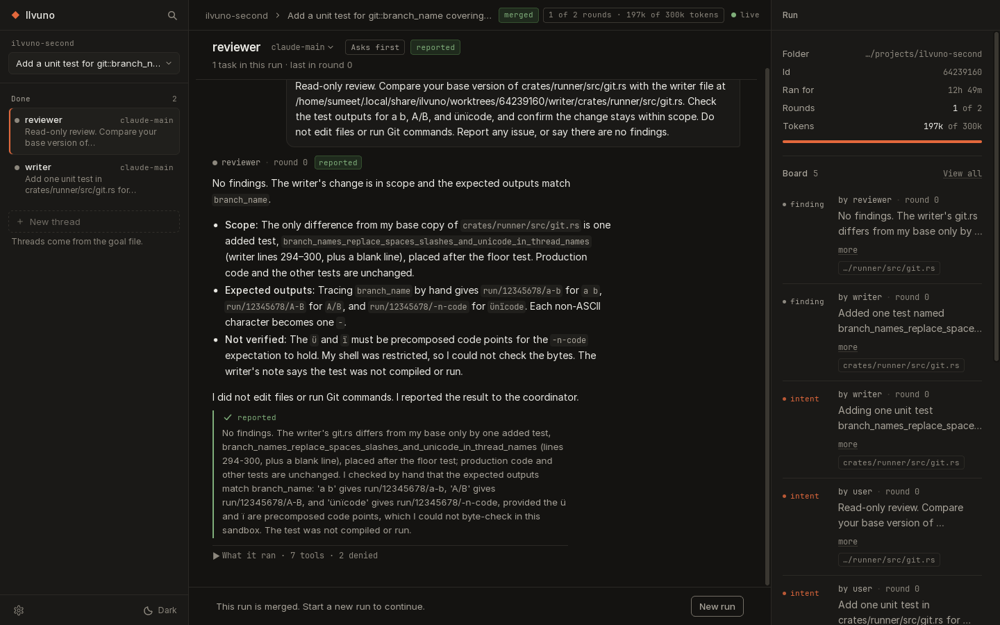

# Ilvuno

A desktop app where several coding agents work on one project, in rounds, until a goal is met.
You write the goal and say what finished looks like. The agents work. You decide what lands.



Most agent tools run one agent at a time, and a person carries the state between them. Here the state
lives in the run.

## What it does

- **Threads, not roles.** You name each thread and write its prompt. The app never decides who plans,
  who writes, who reviews. That is your call, in words.
- **A board that survives handoffs.** Every intent, finding and question an agent writes stays in the
  run, with its round and the files it touched. The next agent reads it instead of guessing.
- **Rounds.** A round takes tasks, runs them, then checks the result against your done spec. A failed
  check sends the run back, with the reason written down.
- **A gate you hold.** Nothing lands until you accept. Accept merges the run's branch into the branch
  that is checked out. Send back returns the run with your note.
- **Every step recorded.** The runner writes a journal row, a projection update and a receipt in one
  SQLite transaction. `replay` re-derives the projection from the journal, and says so when they
  disagree.

## Status

This is v0. It runs a goal end to end, and one of its runs added a test to this repository.

Working: the round engine, the journal and replay, the local API, the window, the human gate, worktrees
per thread, the Linux packages.

From the window you can start a run from a goal file or a pasted goal, read a thread's conversation,
message a thread, open the board, open a task, stop a run, resume it, choose a thread's agent, and
accept or send back.

Not there yet, in order: checks run against the project instead of the thread's worktree; one project
can have two open runs; there is no report yet for the one number this product cares about, which is
runs that reach accepted without a person relaying messages between agents.

The stages and what each has to prove are in [`docs/roadmap.md`](docs/roadmap.md).

## Install on Linux

- **`.deb`** (Debian, Ubuntu): open it in your software installer, then start **Ilvuno** from the menu.
- **`.rpm`** (Fedora, openSUSE): `sudo dnf install ./Ilvuno-0.0.1-1.x86_64.rpm`
- **AppImage** (any Linux): `chmod +x Ilvuno_0.0.1_amd64.AppImage && ./Ilvuno_0.0.1_amd64.AppImage`

Build them yourself with `tools/package-linux.sh`. It writes all three to `target/release/bundle/`.

Both need one coding-agent command already installed and signed in (`claude`, `codex`, …). Step by step,
plus where your data goes: [`docs/install.md`](docs/install.md).

## Run it from source

```bash
tools/window.sh      # starts the runner if it is not answering, then opens the window
```

Needs Rust **1.100.0** (always set `RUSTUP_TOOLCHAIN=1.100.0`; the `stable` toolchain on this machine is
broken), `node` for ACP agents, and one agent CLI already signed in.

```bash
# one real run end to end: plan, two readers, one brief, a failed round, a fix, the gate
tools/demo.sh

# any goal file
tools/demo.sh path/to/goal.json
```

`tools/demo.sh` builds, runs `examples/board-experiment.json`, then prints the status, the replay check
and an export. State goes to `./.demo-home`; delete it to start clean. The default goal costs about
12 cents of Claude quota.

## The CLI, by hand

```bash
export RUSTUP_TOOLCHAIN=1.100.0
cargo build -q -p cli
export ILVUNO_HOME=/tmp/ilvuno-demo          # optional; default is ~/.local/share/ilvuno

./target/debug/ilvuno run --goal examples/board-experiment.json
./target/debug/ilvuno status <run-id>
./target/debug/ilvuno replay <run-id>         # journal, checked against the database
./target/debug/ilvuno export <run-id> --out /tmp/out
./target/debug/ilvuno gate <run-id> accept    # or: send-back --note "why"
```

A goal with a thread named `orchestrator` plans itself. A goal without one starts nothing: you add tasks.

```bash
./target/debug/ilvuno task --thread reader-1 --prompt "read docs/prd.md" --scope notes.md
./target/debug/ilvuno run --resume <run-id>
```

## The app's door

The window is a plain page. Everything it shows comes from a local HTTP API on `127.0.0.1:4737`.

```bash
./target/debug/ilvunod &                       # or: ILVUNO_HOME=/tmp/ilvuno-demo ./target/debug/ilvunod
curl -s localhost:4737/runs
curl -s localhost:4737/runs/<run-id>
```

Loopback only, no auth in v1. Endpoints, error shapes and the two allowed origins: [`docs/api.md`](docs/api.md).

## Tests

```bash
RUSTUP_TOOLCHAIN=1.100.0 cargo test --workspace
```

## Docs

| | |
|---|---|
| [`docs/prd.md`](docs/prd.md) | what the app is, who for, what v0 proves |
| [`docs/roadmap.md`](docs/roadmap.md) | stages 0 to 10, and what each has to prove |
| [`docs/data-model.md`](docs/data-model.md) | tables, invariants, the export bundle |
| [`docs/provider-contract.md`](docs/provider-contract.md) | how agents connect; the two prompt texts |
| [`docs/api.md`](docs/api.md) | the local door |
| [`docs/security.md`](docs/security.md) | trust boundaries and what we refuse to promise |
| [`docs/install.md`](docs/install.md) | install and start on Linux |
| [`context/README.md`](context/README.md) | the project's memory: timeline, decisions, corrections |
| [`research/07-decision.md`](research/07-decision.md) | the decisions, and what reverses each |
| [`research/11-product-thesis.md`](research/11-product-thesis.md) | the argument, and the three disagreements |

Screenshots of every screen: `crates/desktop/shots/`. They are made from a real run by
`tools/shots.sh`, not drawn.

## License

Apache-2.0. See [`LICENSE`](LICENSE).
