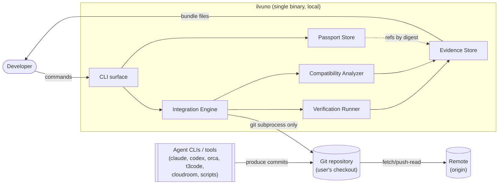
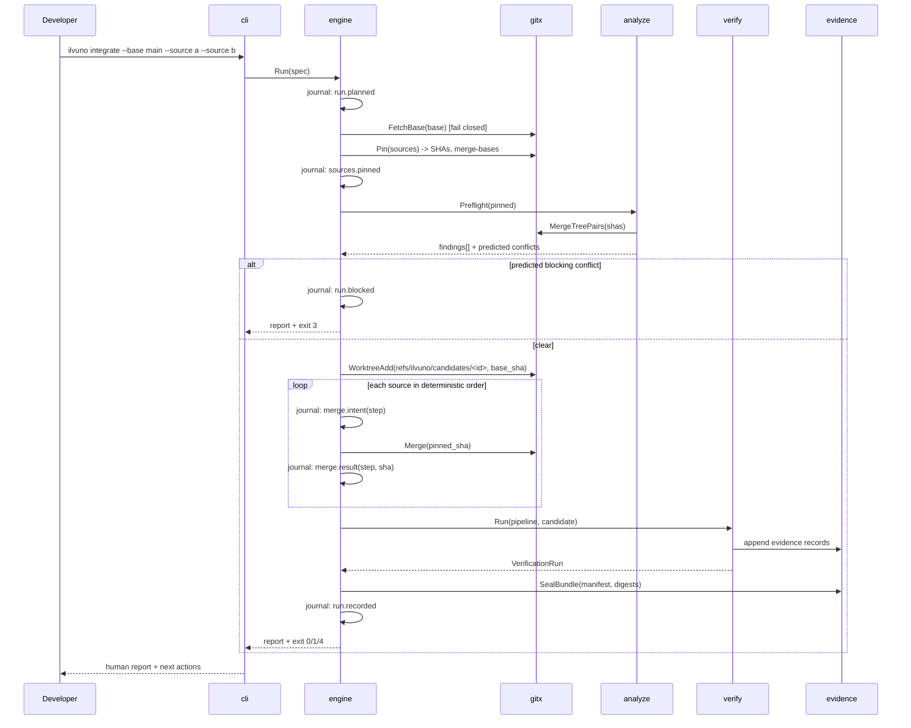

# 01 — Architecture Overview

Status: Phase 3 specification. No implementation. Decisions referenced as `ADR-00NN`
(`docs/adr/`). Requirement IDs resolve in `docs/product/02-prd.md`; evidence IDs (`T3-`,
`ORC-`, `CR-`) in `docs/research/07-evidence-index.md`.

---

## 1. What this architecture must satisfy

The approved MVP (product `05-mvp-scope.md` §4) is a **single-binary, local-first CLI** that
takes git refs in, builds a disposable integration candidate, verifies it, records evidence,
and stops for a human approval. The architecture is shaped by nine hard properties:

| Property | Architectural consequence |
|---|---|
| Local-first | No service dependency in any P0 path; the binary is the system (ADR-0003) |
| Modular | Six bounded modules with explicit interfaces; provider and UI are edges, not core |
| Open-source friendly | Small dependency surface, no proprietary protocol, extension points documented |
| Recoverable after interruption | Journal-before-side-effect, ground-truth reconciliation on resume, no auto-retry of uncertain work |
| Provider-independent core | The core consumes **git refs and commands**, never a provider API (ADR-0010) |
| Explicit about permissions | Every mutating operation has a declared write scope, enforced by one gate |
| Deterministic where correctness matters | Pinned SHAs, fixed commit envelope, no re-resolution of refs (ADR-0005, ADR-0007) |
| Secure by default | Fail closed; verification is recognised as arbitrary code execution, not sandboxed |
| Practical for a small team | One language, one binary, no daemon, no database server, no frontend (ADR-0001, ADR-0002) |

Plus one forward constraint: the same core must be reachable later by a desktop/mobile
client through an authoritative runtime, without a rewrite (doc `10`).

---

## 2. System context



Two hard boundaries in that picture:

1. **Ilvuno never talks to an agent.** Agents produce commits; Ilvuno consumes refs. There is
   no provider SDK, no credential, no session in the MVP (ADR-0010).
2. **Ilvuno never re-implements git.** Every VCS operation is a `git` subprocess, so merge,
   worktree, and conflict semantics are byte-identical to what the developer would get by
   hand (ADR-0004).

---

## 3. Module map

| Module | Responsibility | Owns | Writes | Spec |
|---|---|---|---|---|
| `cli` | Argument parsing, exit codes, human/JSON output, prompts | nothing | stdout/stderr | §6, doc `12` |
| `engine` | Orchestrates an integration run: pin → preflight → candidate → verify → classify → record → approve | run state, journal | `.ilvuno/runs/`, `refs/ilvuno/*` | doc `06` |
| `gitx` | Every git interaction: rev-parse, merge-tree, merge, worktree, diff, hooks suppression | nothing | `refs/ilvuno/*`, `.git/worktrees/` | doc `05` |
| `analyze` | Deterministic findings: overlap, proximity, dependency divergence, interface touch, drift | nothing | findings in report | doc `06` |
| `verify` | Spawns project commands, supervises process groups, captures evidence | child processes | `.ilvuno/runs/<id>/logs/` | doc `07` |
| `evidence` | Append-only, content-addressed record store; redaction; bundle export/verify | bundle integrity | `.ilvuno/bundles/` | doc `08` |
| `passport` | Task state, decisions, approvals, derived state and next actions | task files | `docs/ilvuno/tasks/*.yaml` | doc `02`, `04` |
| `policy` | Single write-scope gate; refuses anything outside the declared scope | nothing | — | doc `09` |
| `model` | Domain types, identifiers, state transitions, schema validation | nothing | — | doc `02` |
| `agent` (post-MVP) | Provider adapters: command / claude / codex / acp | child processes | provider session journals | doc `03` |

Dependency rule (enforced by a lint test, doc `11` §7):

```
cli → engine → {analyze, verify, evidence, passport, gitx, model, policy}
agent → {model, policy}          (post-MVP; never imported by engine)
model, policy → stdlib only
```

`engine` must not import `agent`. That single rule is what keeps the core provider-independent
in practice rather than by intention.

---

## 4. Two plans, one core

The deliverables separate what ships now from what is designed now.

| Concern | MVP (build) | Post-MVP (designed, not built) |
|---|---|---|
| Execution | Local, foreground process | Local daemon + remote host (doc `10`) |
| Agents | `command` adapter only (repair executor, arbitrary tool) | `claude`, `codex`, `acp` adapters (doc `03`) |
| Task state | Passport file in repo | Passport + journal + relay sync |
| Evidence | Local bundles, manual sharing | Hosted retention, signed remote approvals |
| UI | Terminal output + Markdown/JSON | Tauri shell + React, mobile read/approve |
| Transport | none | Loopback WS, then E2EE relay |
| Storage | JSONL + files | Same format, plus indexing if scale demands (ADR-0002) |

The rule that makes this split safe: **the MVP's on-disk formats are the future's wire
formats.** Journal events, findings, passports, and bundles are all versioned, transport-free
documents. A future daemon serves the same documents over a socket; a future phone renders
the same passport. Nothing about the MVP depends on being a one-shot process *except* the
supervision model, which doc `10` §4 isolates.

---

## 5. Technology selection (summary; full reasoning in ADRs)

| Layer | Choice | Rejected | ADR |
|---|---|---|---|
| Language / runtime | **Go** | TypeScript/Node, Rust (for now) | ADR-0001 |
| Git access | **`git` subprocess** | go-git, libgit2, reimplementation | ADR-0004 |
| Persistence | **append-only JSONL + files** | SQLite, embedded KV, job queue | ADR-0002 |
| Queues | **the journal is the queue** | Redis/Asynq, in-memory worker pools | ADR-0002 |
| Event log | **per-run JSONL with seq + digest** | SQLite WAL, Kafka-shaped log | ADR-0002 |
| Schemas | **JSON Schema 2020-12, versioned** | protobuf, avro | ADR-0014 |
| UI | **none in MVP** | Electron, Tauri now, web server | ADR-0003 |
| Transport | **none in MVP** | WebSocket, gRPC, stdio RPC | ADR-0003, doc `10` |
| Agent protocols | **documented only** (SDK / app-server / ACP) | PTY scraping, OSC parsing | ADR-0010 |

Explicitly **not** selected for the MVP because the approved scope has no consumer for them:
SQLite, WebSocket, React, Vite, Electron, Tauri, any HTTP server, any message broker. Each is
evaluated and rejected with a revisit condition in its ADR rather than silently omitted.

---

## 6. Command surface (the MVP contract)

```
ilvuno init                     scaffold ilvuno.toml + .gitignore entry
ilvuno doctor                   environment + config diagnosis
ilvuno integrate                build + verify + record a candidate
ilvuno verify                   run checks against an existing ref/candidate
ilvuno repair                   bounded repair via external command
ilvuno show                     render a run, bundle, task, or conflict
ilvuno approve                  record a digest-bound approval (interactive only)
ilvuno resume                   continue an interrupted run
ilvuno abort                    discard a run's artifacts
ilvuno task new|show|list       passport lifecycle
ilvuno brief                    emit the concurrent-change brief
ilvuno bundle export|verify     portable evidence
ilvuno stats                    the user's own aggregate metrics
ilvuno explain                  why a finding fired, what would change it (doc `12` §5.1)
ilvuno gc                       explicit retention (never automatic; doc `08` §7)
ilvuno key init                 generate the Ed25519 approval key (ADR-0012)
```

Designed, not implemented (doc `10`): `ilvuno serve`, `ilvuno pair`, `ilvuno device
list|revoke`. They are listed here so no reader assumes they exist in v0.1.

Global flags: `--repo <path>`, `--json`, `--quiet`, `--debug`, `--no-color`, `--config <path>`.
Non-interactive detection: `approve` refuses without a TTY (ADR-0012).

Exit codes (contract, tested as a matrix; doc `12` §6):

| Code | Meaning |
|---|---|
| 0 | completed, no deterministic blocking finding |
| 1 | verification failed, or a bounded loop exhausted |
| 2 | usage error, refusal, unsafe input, or environment failure |
| 3 | conflict or policy block (predicted or real) |
| 4 | unverified (no checks configured/executed) |
| 130 | interrupted; state is resumable |

---

## 7. Non-negotiable invariants

Cross-cutting, each with an enforcing test. Full list in doc `02` §7; these six shape the
whole design:

| ID | Invariant | Enforced by |
|---|---|---|
| `INV-1` | The user's `HEAD`, index, working tree, stashes, and refs outside `refs/ilvuno/*` are never modified | `policy` gate + before/after fingerprint test (doc `11` §5) |
| `INV-2` | Every source is operated on by **commit SHA**, never by re-resolving a ref | `gitx.Pin` returns SHAs; no other code path accepts a ref (ADR-0005) |
| `INV-3` | A run's journal records the intent **before** the side effect | `engine` step wrapper; crash-injection matrix (doc `08` §5) |
| `INV-4` | An uncertain side effect is never automatically repeated | `resume` classifies `unknown` and requires an explicit decision |
| `INV-5` | A green verification is `passed`; nothing else is ever rendered as `passed` | five-state model + banned-phrase test (doc `07` §2) |
| `INV-6` | Interpretation never affects exit code or approval eligibility | classify step is pure; gate reads only `deterministic` findings |

Plus one product invariant stated as architecture because it is the whole point:

> `INV-7` — A completed agent run implies nothing about integration. The only artifact that
> can carry an integration claim is an `IntegrationCandidate` with a `VerificationRun` bound
> to its SHA.

---

## 8. Critical request path (integrate)



Note what is absent: no network, no push, no approve, no merge into `main`. `integrate` ends
with an artifact and an exit code (ADR-0006).

---

## 9. Where correctness lives

Three places, deliberately:

1. **Git** decides what merges. We never predict as authoritative; predictions are always
   reconciled against a real merge or a real `merge-tree` tree (doc `06` §4).
2. **Exit codes** decide what passed. Not logs, not model judgement, not a heuristic on
   output text (doc `07` §2).
3. **The journal** decides what happened. Not memory, not a summary, not an agent's claim
   (doc `08` §3).

Everything else — findings text, report prose, brief text — is derived and disposable.

---

## 10. Reading order

| Doc | For |
|---|---|
| `02-domain-model.md` | Types, IDs, state machines, invariants |
| `03-agent-adapters.md` | Post-MVP provider boundary (MVP ships `command` only) |
| `04-task-orchestration.md` | Task lifecycle, passport, approvals, concurrency |
| `05-worktrees.md` | Worktree discovery, ownership, cleanup, limits |
| `06-integration-intelligence.md` | The engine: order, conflicts, analysis, repair |
| `07-verification.md` | Runner, five states, evidence semantics |
| `08-persistence-and-recovery.md` | Journal, bundles, corruption, resume |
| `09-security.md` | Threat model, write scope, redaction, prompt injection |
| `10-cross-device.md` | Authoritative runtime, pairing, replay (future) |
| `11-testing.md` | Fixture forge, property tests, crash matrix |
| `12-observability.md` | Logs, metrics, doctor, debuggability |

Unresolved technical decisions and recommended experiments: `docs/adr/README.md` §3–§4.
