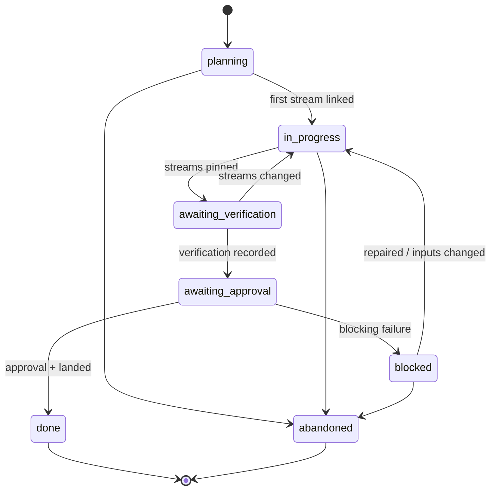
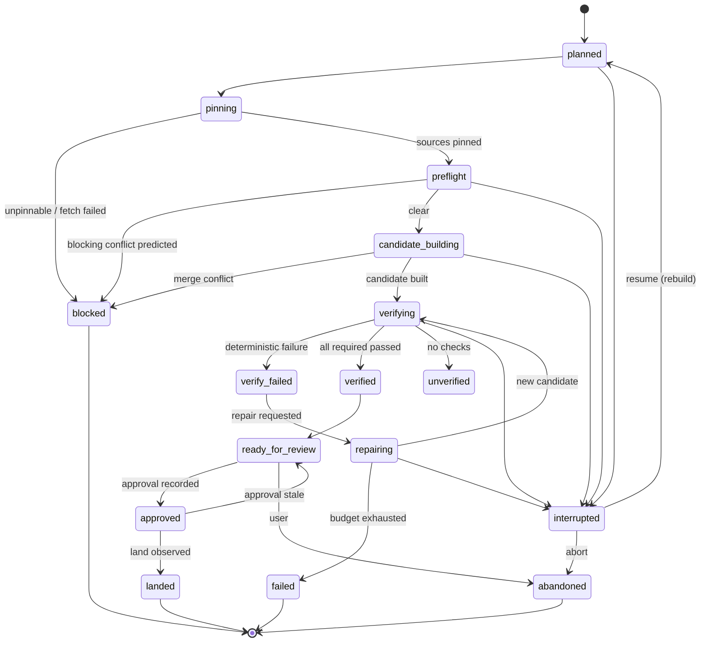

# 02 — Domain Model

Status: specification. Types are language-neutral; field names are the JSON/wire names and
are normative (schemas in ADR-0014). `INV-*` references are defined in §8.

---

## 1. Modelling rules

1. **Every entity has an immutable, opaque identifier.** No path, no index, no SQL rowid is
   ever an identity (`INV-8`).
2. **State changes are transitions, not assignments.** A field named `state` is only writable
   through a transition function that validates the current state (§4). There is no
   `setState`.
3. **Derived values are marked `derived`** and are recomputed, never stored as truth.
4. **Ownership is singular.** Every mutable entity has exactly one owner (§3) that is the
   only writer. Cross-owner writes are a bug class, not a style choice.
5. **Content is addressed by digest.** Anything crossing a boundary (evidence, bundles,
   approvals) carries `sha256:` so it can be checked later.
6. **Timestamps are UTC, RFC3339 with milliseconds.** Sequence numbers are per-run monotonic
   integers starting at 1.
7. **No absolute paths** anywhere in persisted documents (`INV-9`); repo-relative paths only.

---

## 2. Identifier scheme

```
<prefix>_<base32(lowercase, no padding)>
```

| Entity | Prefix | Construction | Why |
|---|---|---|---|
| Project | `prj_` | `sha256(normalize(origin_url))`; fallback `sha256(root_commit_sha)` | Stable across clones and machines (portability) |
| ExecutionHost | `hst_` | random 128-bit | Tied to a machine, never derived from hostname (privacy) |
| Task | `tsk_` | random 128-bit at creation | Must be stable in a committed file |
| Decision | `dec_` | random 64-bit | Immutable, addressable from prose |
| AgentRun | `run_` | `<UTC compact>-<rand32>` | Sortable, debuggable in a directory listing |
| ProviderSession | `psn_` | random 128-bit | Post-MVP; opaque to Ilvuno |
| Worktree | `wt_` | `<project_short>-<rand32>` | Matches directory name for humans |
| IntegrationRun | `irn_` | `<UTC compact>-<rand32>` | Sortable; directories are named after it |
| IntegrationCandidate | `cnd_` | `<irn_short>-<step_count>` | Encodes lineage at a glance |
| VerificationRun | `vrf_` | random 64-bit | Multiple per candidate |
| EvidenceRecord | `evd_` | random 64-bit | Bundled, referenced by digest too |
| EvidenceBundle | `evb_` | `<UTC compact>-<rand32>` | Matches directory name |
| Approval | `apr_` | random 64-bit | Referenced from reports |

Rules:
- `prj_` derivation is recorded (`origin` or `root-commit`) because a shallow clone without a
  remote falls back, and a project must never silently become two projects.
- Time-based IDs use `YYYYMMDDTHHMMSSZ` (16 chars) so `ls` sorts chronologically.
- Identifiers are never reused, never recycled after deletion, and never derived from
  mutable content other than the two documented cases above (`INV-8`).

---

## 3. Entities

### 3.1 Project

The unit of configuration and trust. One repo checkout = one project, identified independent
of its path.

| Field | Type | Notes |
|---|---|---|
| `id` | `prj_*` | see §2 |
| `id_derivation` | `"origin" \| "root-commit"` | recorded so a divergence is detectable |
| `display_name` | string | from directory or remote basename; cosmetic only |
| `config_digest` | `sha256:*` | digest of `ilvuno.toml` at the time of a run |
| `default_base_ref` | string | e.g. `main`; **always re-pinned to a SHA before use** |
| `verification_commands[]` | `CommandSpec` | see §5.1 |
| `limits` | `Limits` | candidate caps, timeouts |
| `owner` | — | The `policy` gate; the project is the root write scope |

Constraints: `verification_commands` may be empty (→ `unverified`, `INV-5`), but `init` must
report that consequence at creation time.

### 3.2 Task

The durable unit of intent. A task survives branches, agents, machines, and weeks.

| Field | Type | Notes |
|---|---|---|
| `id` | `tsk_*` | |
| `project_id` | `prj_*` | |
| `slug` | `[a-z0-9-]{1,64}` | unique per project; names the passport file |
| `objective` | string (≤4 KiB) | required |
| `acceptance_criteria[]` | `Criterion` | required, ≥1; each names a check or a manual statement |
| `state` | `TaskState` | derived (§4.1) |
| `decisions[]` | `Decision` | append-only |
| `streams[]` | `StreamRef` | `source_ref`, `pinned_sha`, `agent_run_id?` |
| `verification_refs[]` | `BundleRef` | by bundle id + digest, never a copy |
| `approvals[]` | `ApprovalRef` | by id + digest |
| `next_actions[]` | string | `derived` |
| `not_included[]` | string | normative honesty block (`TSK-112`) |
| `created_at`, `updated_at` | timestamp | `updated_at` is derived from the last record |

Ownership: `passport` module is the only writer. Agents and users may edit the file by hand,
which is *allowed* and *detectable*: the file carries a `digest_chain` (§3.13).

### 3.3 TaskDependency

Modelling as little as possible while keeping batches honest.

| Field | Type | Notes |
|---|---|---|
| `id` | `tdp_*` | |
| `from_task_id` | `tsk_*` | must complete first |
| `to_task_id` | `tsk_*` | blocked until `from` is `done` |
| `kind` | `"blocks" \| "informs"` | `informs` never blocks; advisory only |
| `note` | string? | |

Constraints: no cycles (checked on insert, `INV-10`); `blocks` edges propagate a `blocked`
state with a reason; `informs` edges are rendered but never affect eligibility. No DAG engine,
no scheduling — MVP has no dispatch (product `05` §4.2).

### 3.4 AgentRun

A record of one external agent execution, whatever produced it. In the MVP this is usually
*imported* (the developer ran the agent themselves) rather than launched.

| Field | Type | Notes |
|---|---|---|
| `id` | `run_*` | |
| `task_id` | `tsk_*`? | optional: imported runs may be unowned |
| `provider` | `"claude" \| "codex" \| "acp:<id>" \| "command" \| "external"` | `external` = user ran it, we only record |
| `provider_session_id` | string? | **never assumed portable** (`TSK-112`) |
| `started_at`, `ended_at` | timestamp | `ended_at` may be absent while running |
| `state` | `AgentRunState` | §4.2 |
| `produced_refs[]` | `RefFact` | `{ref, sha}` captured by us via git, never from agent text |
| `reported_files[]` | string[]? | what the agent *said* it changed (untrusted) |
| `claimed_status` | `"done" \| "failed" \| "unknown"` | a claim; never evidence (`INV-7`) |
| `exit` | `ExitFact`? | `{code, signal, duration_ms}` when we launched it |
| `host_id` | `hst_*` | which machine ran it |

Invariant: **`claimed_status` never influences any gate.** It is stored specifically so a
`claim_divergence` finding can be produced when it disagrees with git (doc `06` §6).

### 3.5 ProviderSession

Post-MVP. Exists in the model now so evidence written today remains interpretable later.

| Field | Type | Notes |
|---|---|---|
| `id` | `psn_*` | |
| `agent_run_id` | `run_*` | |
| `provider` | string | |
| `external_session_id` | string | provider's own id; opaque |
| `resume_token` | string? | provider-specific; **not portable across hosts** (`TSK-112`, `XDC-102`) |
| `capabilities` | `CapabilitySet` | `{steer, interrupt, fork, rollback, compact}` |
| `mutations` | `SessionMutation[]` | `{at, kind: "resume"\|"fork"\|"compact", ok}` |

Non-goal encoded in the type: there is no field for transcript content. Ilvuno never stores
conversation (`TSK-112`, product §17.3, evidence ORC-022/CR-016 for why resume is
provider-bound).

### 3.6 ExecutionHost

The machine that actually owns worktrees and processes.

| Field | Type | Notes |
|---|---|---|
| `id` | `hst_*` | random; not a hostname (`INV-9`) |
| `kind` | `"local" \| "remote"` | MVP only ever `local` |
| `os`, `arch` | `"darwin"\|"linux"`, `"arm64"\|"amd64"` | capability gating |
| `git_version` | semver | `merge-tree --write-tree` needs ≥2.38 (ADR-0006) |
| `ilvuno_version` | semver | determinism envelope (ADR-0007) |
| `capabilities` | `{worktree, merge_tree, hooks_override, process_groups}` | probed by `doctor` |
| `paired_devices[]` | `DeviceRef` | post-MVP (doc `10`) |

Ownership: the host owns every `Worktree` it creates and every child process. A worktree is
never migrated between hosts; only *evidence* and *task state* travel (doc `10` §5).

### 3.7 Worktree

| Field | Type | Notes |
|---|---|---|
| `id` | `wt_*` | |
| `host_id` | `hst_*` | |
| `project_id` | `prj_*` | |
| `path` | repo-relative | never absolute (`INV-9`) |
| `purpose` | `"candidate" \| "repair" \| "verify"` | no `"agent"` in MVP — we do not dispatch |
| `ref` | string | always `refs/ilvuno/...` |
| `head_sha` | sha | observed, journaled |
| `state` | `WorktreeState` | §4.4 |
| `run_id` | `irn_*`? | the owning run |
| `created_at` | timestamp | |
| `cleanup_eligible_at` | timestamp? | set when the run settles |

Hard constraint: a worktree whose `ref` is not under `refs/ilvuno/` may not be created or
removed by Ilvuno. A pre-existing user worktree may be *observed* (read-only) but never
adopted (`INV-1`, product `ORQ-101`).

### 3.8 IntegrationRun

The unit of one integration attempt. This is the state machine the whole product hangs on.

| Field | Type | Notes |
|---|---|---|
| `id` | `irn_*` | |
| `task_id` | `tsk_*`? | |
| `host_id` | `hst_*` | |
| `base_ref`, `base_sha` | string, sha | `base_sha` is the only thing used downstream |
| `sources[]` | `PinnedSource` | `{ref, sha, merge_base_sha, ahead, behind, order}` |
| `order` | sha[] | explicit, journaled, so a run is reproducible |
| `state` | `IntegrationState` | §4.3 |
| `steps[]` | `MergeStep` | `{index, source_sha, pre_sha, post_sha, strategy, result}` |
| `candidate_id` | `cnd_*`? | |
| `verification_ids[]` | `vrf_*` | |
| `bundle_id` | `evb_*`? | |
| `approval_id` | `apr_*`? | |
| `uncertain[]` | `Uncertainty` | what a crash left unresolved (§4.6) |
| `exit_code` | int? | the contract value the run produced |

### 3.9 IntegrationCandidate

A disposable, reproducible commit that represents "all these sources, together".

| Field | Type | Notes |
|---|---|---|
| `id` | `cnd_*` | |
| `run_id` | `irn_*` | |
| `ref` | `refs/ilvuno/candidates/<run_id>` | |
| `sha` | sha | deterministic given (inputs, ilvuno version) |
| `tree_sha` | sha | |
| `parent_shas[]` | sha[] | base first, then merge commits |
| `included_sources[]` | sha[] | |
| `excluded_sources[]` | `{sha, reason}[]` | partial integration (`INT-109`) |
| `created_at` | timestamp | fixed by the determinism envelope |
| `disposable` | `true` | literal constant; the type makes the intent unmissable |

Constraints: `sha` is never `base_sha` (a candidate always contains at least one merge);
parents are topologically ordered; the ref is never `main`/`master`/the base ref (`INV-1`).

### 3.10 VerificationRun

| Field | Type | Notes |
|---|---|---|
| `id` | `vrf_*` | |
| `candidate_id` | `cnd_*` | |
| `candidate_sha` | sha | results are bound to a SHA (`VER-103`) |
| `state` | `VerificationState` | five outcomes, §4.5 |
| `commands[]` | `CommandResult` | one per configured command, including skips |
| `started_at`, `ended_at` | timestamp | |
| `tree_before`, `tree_after` | sha | detects a command that mutated the candidate |
| `environment` | `EnvFingerprint` | allowlist + hashes, **never values** |
| `attempt` | int | 1 for the first run |

### 3.11 EvidenceRecord

The atom of truth. Append-only; there is no update operation.

| Field | Type | Notes |
|---|---|---|
| `id` | `evd_*` | |
| `seq` | int | monotonic within a bundle |
| `at` | timestamp | |
| `kind` | `EvidenceKind` | `{command, git, finding, claim, approval, note}` |
| `subject` | `SubjectRef` | what it is about: sha, path, finding id, claim id |
| `status` | `"passed"\|"failed"\|"unverified"\|"inconclusive"\|"error"\|"informational"` | |
| `data` | object | kind-specific payload |
| `blob` | `BlobRef`? | `{path, sha256, bytes}` for logs |
| `prev_digest` | `sha256:*`? | hash chain within the bundle |
| `digest` | `sha256:*` | digest of the canonical serialization |

Constraints: `data` may not contain a secret value (`INV-13`); records with
`status: "passed"` must carry at least one `SubjectRef` that is a commit SHA or a command
result (`EVD-104`).

### 3.12 Approval

| Field | Type | Notes |
|---|---|---|
| `id` | `apr_*` | |
| `run_id` | `irn_*` | |
| `candidate_sha` | sha | **the** binding |
| `evidence_digest` | `sha256:*` | digest of the bundle manifest at approval time |
| `scope` | `"land" \| "repair"` | |
| `decision` | `"approved" \| "rejected"` | |
| `by` | `Principal` | `{kind: "local-user", label, key_id?}` |
| `signature` | `sig:*`? | Ed25519 over the canonical approval body, when a key exists |
| `at` | timestamp | |
| `invalidated_by` | string? | reason: `inputs_changed`, `evidence_missing`, `digest_mismatch` |

Constraint (`INV-6`, `INT-603`): an approval is valid only if
`sha == candidate.sha` **and** `evidence_digest` matches a bundle that still exists and
verifies. Changing any input invalidates rather than edits (`stale_approval`).

### 3.13 Decision

| Field | Type | Notes |
|---|---|---|
| `id` | `dec_*` | |
| `task_id` | `tsk_*` | |
| `text` | string | the decision |
| `rationale` | string | required; a decision without a reason is a preference |
| `decided_by` | `Principal` | |
| `at` | timestamp | |
| `supersedes` | `dec_*`? | immutability: change = new record |
| `affects[]` | string[] | paths/areas, for the brief |

### 3.14 TaskPassport

Not a separate aggregate — the **versioned on-disk projection** of `Task` plus its
`decisions`, `streams`, `verification_refs`, `approvals`, and derived state. One file,
`docs/ilvuno/tasks/<slug>.yaml`, schema `ilvuno.dev/passport/v1`.

| Section | Source of truth | Notes |
|---|---|---|
| `task`, `objective`, `acceptance_criteria` | file | authored |
| `decisions[]` | file | authored, append-only |
| `state`, `next_actions` | **derived** | recomputed on read; a hand-edited value is ignored and reported |
| `streams[]` | file, SHAs verified against git | dangling SHAs flagged, never repaired silently |
| `verification[]` | file (bundle refs) | resolved from `.ilvuno/bundles/`; missing → `evidence_missing` |
| `approvals[]` | file (approval refs + digests) | verified against local signed records |
| `digest_chain` | file | hash chain over the semantic body; detects hand-edits and agent edits |

The digest chain is the mechanism behind the honest security claim in doc `09` §3: a file in
a repo can be edited by anything that can write the repo, including an agent. Ilvuno cannot
prevent that. It can make it *visible*: a passport whose chain does not verify is rendered
`tampered`, its approvals are `unverifiable`, and no gate opens on it.

---

## 4. State machines

All transitions are validated; an illegal transition is a bug that fails a property test
(doc `11` §4). `→` means "may transition to".

### 4.1 Task



| From | To | Trigger | Guard |
|---|---|---|---|
| `planning` | `in_progress` | first stream linked | ≥1 criterion |
| `in_progress` | `awaiting_verification` | streams pinned | all streams have SHAs |
| `awaiting_verification` | `in_progress` | source changed | new SHA ≠ old |
| `awaiting_verification` | `awaiting_approval` | verification recorded | run settled |
| `awaiting_approval` | `blocked` | blocking finding | `deterministic` + blocking |
| `awaiting_approval` | `done` | approval valid **and** landed | approval not stale |
| `blocked` | `in_progress` | inputs changed or repair produced a new candidate | — |
| any non-terminal | `abandoned` | user action | requires explicit confirmation |
| `done` | `done` | evidence pruned | tombstone recorded (`TSK-113`) |

`state` is derived: `done` requires a valid approval **and** an observed land (the base ref
containing the candidate's content). Ilvuno never performs the land (`INT-604`), so it infers
it from git on read, and marks `done` as `derived`, not authored.

### 4.2 AgentRun

| From | To | Trigger | Guard |
|---|---|---|---|
| `requested` | `running` | process started | host capability ok |
| `running` | `completed` | exit 0 **and** produced refs observed | — |
| `running` | `failed` | exit ≠ 0 | — |
| `running` | `cancelled` | user interrupt | — |
| `running` | `lost` | process gone, no exit observed | reconciliation |
| `running` | `uncertain` | crash/restart, outcome unknown | never auto-resolved (`INV-4`) |
| `completed` | — | terminal | |

`completed` means only "the process ended successfully and we saw a commit". It carries no
integration meaning (`INV-7`).

### 4.3 IntegrationRun



Canonical states: `planned | pinning | preflight | candidate_building | verifying |
verify_failed | unverified | repairing | verified | ready_for_review | approved | landed |
blocked | failed | abandoned | interrupted`.

Terminal-vs-resumable is explicit: `interrupted` is resumable; `blocked`, `failed`,
`abandoned`, `landed` are terminal for that run (a new run is created instead).

### 4.4 Worktree

| From | To | Trigger |
|---|---|---|
| `creating` | `ready` | `git worktree add` succeeded |
| `creating` | `failed` | add failed (rolled back) |
| `ready` | `dirty` | command mutated the tree |
| `ready`/`dirty` | `removing` | run settled |
| `removing` | `removed` | `git worktree remove` + ref delete |
| `removing` | `orphaned` | removal failed; journaled for retry |

`orphaned` is a recorded, repairable state, not an error the user must clean by hand
(`REC-104`).

### 4.5 VerificationRun

Five outcomes, no others (`INV-5`):

| Outcome | Condition | Blocks approval |
|---|---|---|
| `passed` | every `required` command exited 0 | no |
| `failed` | any `required` command exited ≠ 0 (or timed out) | yes |
| `unverified` | zero commands configured | yes |
| `inconclusive` | a command did not run (setup error, env failure) or double-run disagreed | yes |
| `error` | the runner itself failed (spawn error, disk full) | yes |

`advisory` commands (`required: false`) that fail do not change the outcome; they are
recorded as advisory failures and shown.

### 4.6 Uncertainty (the crash model)

One record type covers "we do not know": `Uncertainty{seq, step, kind, resolution}`.

| Kind | Meaning | Allowed resolutions |
|---|---|---|
| `merge_outcome_unknown` | intent journaled, merge result not | `remerge` (rebuild from scratch) or `abort` |
| `verify_outcome_unknown` | child was running at crash | `rerun` or `abort` |
| `bundle_write_unknown` | sealing interrupted | `reseal` or `abort` |
| `cleanup_unknown` | removal interrupted | `retry` or `leave` |

There is no `auto` resolution (`INV-4`). `resume` lists uncertainties and requires an explicit
`--decide=` per kind, or refuses.

---

## 5. Value objects

### 5.1 CommandSpec / CommandResult

```
CommandSpec   { name, run, cwd?, timeout, required, env_allow[], redact[] }
CommandResult { name, argv[], cwd, exit, signal?, duration_ms,
                stdout: BlobRef, stderr: BlobRef,
                out_digest, status, advisory, skipped_reason? }
```

`run` is a shell string executed as `sh -c` (recorded verbatim, quoted into argv); `argv` in
the result is what was actually executed. `cwd` is repo-relative and must be inside the
candidate worktree (`INV-12`).

### 5.2 Finding

```
Finding {
  id, classification: "deterministic" | "interpretation",
  kind, severity: "blocking" | "warning" | "info",
  subject: { sources[], paths[], shas[] },
  evidence_refs[], message, data{},
  predicted: bool          // true when produced without performing the operation
}
```

`classification` is mandatory and schema-enforced (`INT-206`). `severity: blocking` is only
legal for `deterministic` findings (`INV-6`).

### 5.3 BlobRef / BundleRef

```
BlobRef   { path (repo-relative or bundle-relative), sha256, bytes }
BundleRef { bundle_id, manifest_digest, status }
```

### 5.4 Principal

```
Principal { kind: "local-user" | "device" | "system", label, key_id? }
```

`system` is used only for derivations (e.g. `state` recomputation), never for approvals.

---

## 6. Ownership matrix

| Entity | Sole writer | Readers |
|---|---|---|
| Project config | user (file) | all modules |
| Task / Decisions | `passport` | `engine`, `cli` |
| TaskPassport file | `passport` (or user/agent — detectable) | all |
| AgentRun | `engine` (imported) / `agent` (launched, post-MVP) | `passport`, `analyze` |
| Worktree | `gitx` via `engine` | `verify`, `analyze` |
| IntegrationRun | `engine` | `cli`, `passport` |
| IntegrationCandidate | `gitx` (creates refs) | `verify`, `analyze` |
| VerificationRun | `verify` | `engine`, `passport` |
| EvidenceRecord | `evidence` (append-only) | all |
| Approval | `cli` (interactive) + `policy` | `passport`, `engine` |
| Decision | `passport` | `report`, `brief` |

Cross-writer access is a compile-time/lint-level error where language permits, and a test
otherwise (doc `11` §7).

---

## 7. Constraints (structural, checkable on write)

| ID | Constraint | Checked at |
|---|---|---|
| `C-1` | Every persisted path is repo-relative | schema + `passport`/`evidence` writers |
| `C-2` | `IntegrationRun.sources[].sha` resolves to an existing commit object | before every merge |
| `C-3` | Candidate ref matches `refs/ilvuno/candidates/<run_id>` exactly | `gitx` |
| `C-4` | `VerificationRun.candidate_sha` equals its candidate's `sha` | `verify` on write |
| `C-5` | `Approval.evidence_digest` resolves to a verifying bundle | `policy` on read |
| `C-6` | `Finding.severity: blocking` ⇒ `classification: deterministic` | schema |
| `C-7` | `EvidenceRecord.status: passed` ⇒ has a commit-SHA or command-result subject | schema |
| `C-8` | No two live tasks share a `slug` in one project | `passport` |
| `C-9` | `TaskDependency` graph is acyclic | `passport` on insert |
| `C-10` | No bundle contains a record whose `data` matches the secret heuristic | `evidence` on write |
| `C-11` | Journal `seq` is contiguous per run; gaps are a corruption signal | `evidence` on read |
| `C-12` | A `devices[]` entry (post-MVP) must be `revoked` before its key is reused | doc `10` |

---

## 8. Invariants

| ID | Invariant | Enforcement |
|---|---|---|
| `INV-1` | User working tree, index, `HEAD`, stashes, and non-`refs/ilvuno/*` refs are never modified | `policy` gate + fingerprint test |
| `INV-2` | Sources are operated on by SHA only; a ref is resolved exactly once | `gitx.Pin` is the only ref resolver |
| `INV-3` | Intent is journaled and fsynced before the side effect | `engine` step wrapper |
| `INV-4` | No uncertain side effect is auto-retried | `resume` requires `--decide` |
| `INV-5` | Only a fully-passed verification is rendered `passed` | outcome enum + banned-phrase test |
| `INV-6` | Interpretation cannot affect exit code or approval eligibility | classify is pure; gate filters by classification |
| `INV-7` | A completed agent run implies nothing about integration | no code path from `AgentRun.state` to an approval or a `passed` |
| `INV-8` | Identifiers are opaque, immutable, never reused | generator + test |
| `INV-9` | No absolute paths or machine identifiers in persisted documents | path lint (doc `11` §6) |
| `INV-10` | Task dependency graph is acyclic | insert-time check |
| `INV-11` | Candidate construction never runs user hooks or signing | `gitx` forces `-c core.hooksPath=` , `commit.gpgsign=false` (ADR-0013) |
| `INV-12` | Every command `cwd` is inside the owning worktree | `verify` path check |
| `INV-13` | No secret value is written to any artifact | write-time redaction (doc `09` §6) |
| `INV-14` | Deleting `.ilvuno/` never leaves the repo unreadable | nothing outside it is required to read a report |

`INV-7` deserves a note because it is the product's spine. There is deliberately **no**
function that maps `AgentRun.state == completed` to any approval, gate, or status field. The
only path to an approval runs through `VerificationRun` bound to a `candidate_sha`. That
absence is testable: a test asserts no such mapping exists in the final report model (doc
`11` §3, case `T-COMP-4`).

---

## 9. Derived state and next actions

`state` and `next_actions` are pure functions of the record set:

```
task_state = f(streams, verification_refs, approvals, task_dependencies)
next_actions = [
  for each blocking verification_ref:      "repair <failed check> on <candidate>"
  for each stale approval:                 "re-run and re-approve"
  for each blocking finding:               "resolve <finding kind> between <sources>"
  for each blocking dependency:            "finish <task> first"
  if all green and no approval:            "approve <candidate>"
]
```

Determinism requirement: identical record sets produce byte-identical `state` and
`next_actions` (doc `11` §4, `DET-3`). This is what makes `ilvuno task show` trustworthy on a
second machine without any server.

---

## 10. Open questions raised by the model

| ID | Question | Recommendation |
|---|---|---|
| `DM-1` | Is `Task.state = done` inferred from observed `land`, or must the user confirm? | Infer, label `derived`, allow `--mark-landed <sha>` to assert explicitly when the commit was squashed |
| `DM-2` | Should `AgentRun` exist at all in MVP if we import instead of launch? | Keep it: imported runs are how `claim_divergence` and the brief become possible without dispatch |
| `DM-3` | One passport file per task vs one per batch? | Per task; parent/child via `TaskDependency` (`kind: informs`) |
| `DM-4` | Should `Approval` be stored in the passport or only in `.ilvuno/`? | Both: passport holds the ref + digest (portable), `.ilvuno/` holds the signed record (verifiable) |
