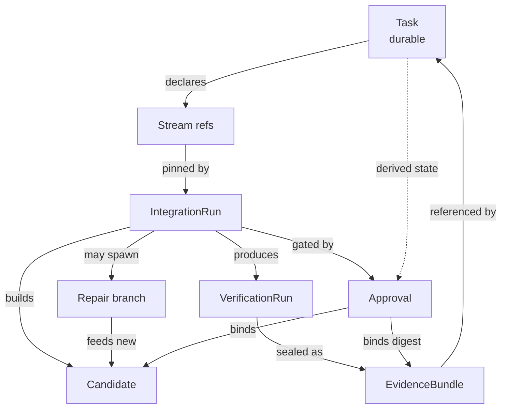
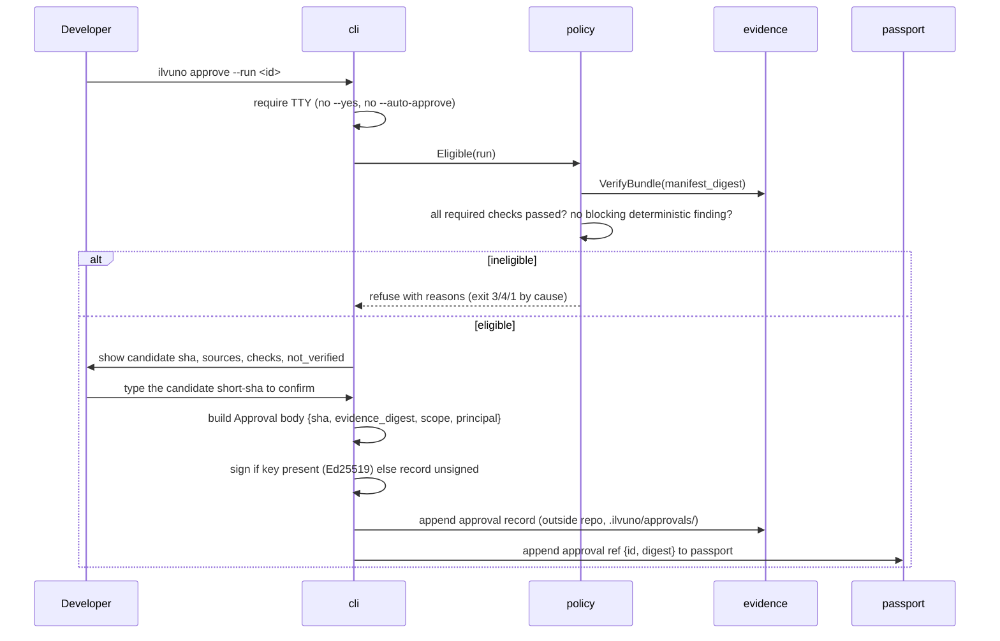

# 04 — Task Orchestration

Status: specification for the MVP. Covers how runs are sequenced, how the Passport is written,
how approvals are produced and invalidated, and how concurrency is bounded. Dispatch
(starting agents) is out of scope (product `05` §4.2; seam at `ORQ-10x`).

---

## 1. What "orchestration" means without dispatch

The MVP does not start agents, so orchestration here is narrower than in orca or t3code:

| Concern | MVP | Post-MVP |
|---|---|---|
| Sequencing | One integration run at a time per project; explicit queue by refusal | Multiple runs, admission control |
| Concurrency | Verification commands sequential; at most *N* concurrent runs (default 1) | Parallel streams with caps |
| Ownership | Task owns streams; run owns candidate | Worktree pools, per-stream processes |
| Recovery | Journal + `resume`/`abort` | Same primitives, plus a daemon |
| Approval | Interactive, digest-bound, local | Remote, device-signed |

The design goal is that **adding dispatch later does not change these primitives** — a
dispatch layer would create `AgentRun`s and `Worktree`s through the same APIs the engine
already uses.

---

## 2. Orchestration objects and their lifetime



Lifetime rules:

| Object | Created | Destroyed | Survives process death |
|---|---|---|---|
| Task / Passport | user | never (abandoned is a state) | yes (file) |
| Stream ref | user/agent or import | never (it is a git ref) | yes (git) |
| IntegrationRun | each `integrate` | `abort` (journal retained) | yes (journal) |
| Candidate ref | engine | `abort`, or cleanup when run settles | yes (git ref) |
| VerificationRun | engine | never (evidence) | yes (evidence) |
| EvidenceBundle | engine at seal | `bundle prune` with tombstone | yes (files) |
| Approval | user | never (invalidation is a field) | yes (record) |
| Repair branch | engine/report | `abort` | yes (git ref) |

`abort` is the only deletion path, and it deletes only objects this run created (`INV-1`,
`REC-107`).

---

## 3. Run sequencing

### 3.1 Single-run lock

One mutating run per project at a time, enforced by an advisory lock:
`.ilvuno/locks/project.lock` containing `{pid, host_id, boot_id, started_at, run_id}`.

| Situation | Behaviour |
|---|---|
| Lock free | acquire, proceed |
| Lock held by a live process on this host | refuse: `run_in_progress (run <id>)`, exit 2 |
| Lock held by a dead process on this host | stale lock: log, take over, record `stale_lock_recovered` |
| Lock held by another host | refuse; MVP is single-host (doc `10` §5) |

Lock file is created with `O_EXCL`; staleness is decided by the `(pid, start_time, boot_id)`
triple, never by mtime alone. mtime is used only as a tiebreaker when the triple cannot be
read (corrupt lock), and then the run refuses and says so.

Read-only commands (`show`, `stats`, `bundle verify`, `doctor`, `task show`) never take the
lock.

### 3.2 Why a queue is unnecessary

The MVP has no daemon, so there is nothing to queue: a refused run is an exit code, and the
developer re-runs. Research `reliability` guidance from t3code (single transactional commit of
state+outbox, T3-018) and cloudroom (fsynced receipts, CR-012) is honoured by the journal
(§4), not by a scheduler. ADR-0002 records the rejection of a persistent queue with its
revisit condition (a daemon with multiple producers).

---

## 4. The journal is the coordination mechanism

Every run is a sequence of steps. Each step has one shape:

```
step(seq, kind, intent, perform, record)
  1. append {kind}.intent      + fsync
  2. perform side effect
  3. append {kind}.result      + fsync
  4. if perform returned without a definitive result → append uncertainty
```

Consequences:

- A crash between (1) and (3) is *detectable* and lands in `interrupted` with an
  `Uncertainty` (doc `02` §4.6).
- A duplicated invocation of the same command id returns the recorded result instead of
  repeating the side effect (`REC-105`). Command ids are `(run_id, seq)`.
- Journal ordering is the only ordering. There is no in-memory state that a reader must
  reconstruct (`INV-3`).

### 4.1 Step kinds

| Kind | Intent payload | Result payload |
|---|---|---|
| `base.fetch` | ref, remote | sha, fetch_ok, git_version |
| `source.pin` | ref | sha, merge_base, ahead, behind |
| `preflight.run` | shas[], order | findings[], conflicts[], tool |
| `worktree.add` | ref, base_sha | path, head_sha |
| `merge` | index, source_sha, pre_sha | post_sha, strategy, conflicts[] |
| `verify.start` | candidate_sha, commands[] | vrf_id |
| `verify.command` | name, argv, cwd, timeout | exit, duration, blob refs, status |
| `verify.end` | vrf_id | state, required_passed |
| `bundle.seal` | records[] | manifest_digest, bundle_id |
| `repair.start` | budget, bundle_id | attempt, branch ref |
| `repair.attempt` | attempt, brief_digest | exit, produced_refs[] |
| `approval.record` | candidate_sha, evidence_digest | apr_id, signature |
| `cleanup` | worktree ids | removed[], orphaned[] |

The step list is also the report's timeline (doc `12` §3), so the journal does double duty:
crash recovery and user-visible history. That is deliberate — two sources of truth for
"what happened" would drift.

---

## 5. Passport write protocol

The Passport is a repo-committed YAML file. Writes are:

1. **atomic**: write `*.tmp` in the same directory, `fsync`, `rename`, `fsync(dir)`.
2. **validated**: against `ilvuno.dev/passport/v1` before rename.
3. **digest-chained**: `digest_chain` covers the semantic body (`task`, `objective`,
   `acceptance_criteria`, `decisions`, `streams`). Derived sections (`state`,
   `next_actions`) are excluded so a recompute does not change the chain.
4. **never silently merged**: if the file on disk does not match the last digest the module
   read (concurrent edit), the write is refused with `passport_conflict` and the user is
   shown a diff. No three-way merge, no last-writer-wins.

The last rule matters in practice: an agent with repo write access, a `git checkout`, or a
second editor can all change the file. Refusing with a diff is slower than merging and much
safer than losing a decision.

### 5.1 Who may write which section

| Section | Writable by `passport` | Writable by user | Writable by agent (effectively) |
|---|---|---|---|
| `objective`, `acceptance_criteria` | yes (with user intent) | yes | yes — detectable |
| `decisions` | yes (append only) | yes (append only) | yes — detectable, but a decision is not an approval |
| `streams` | yes (adds SHAs it observed) | yes | yes |
| `verification[]` | yes (refs only) | yes | yes — but a ref that does not resolve is `evidence_missing` |
| `approvals[]` | yes (refs + digest) | yes | yes — **and this is why approval validity also requires a local signed record** (doc `09` §4.5) |
| `state`, `next_actions` | recomputed; hand edits ignored | — | — |

The table is the honest version of "the passport is agent-writable": everything textual can be
edited, so nothing textual is trusted for a gate.

---

## 6. Approval flow



Rules:

| Rule | Rationale |
|---|---|
| TTY required; no `--yes` | `INT-602`; an approval that can be automated is not an approval |
| Typed confirmation of the short SHA | defends against muscle-memory approval of the wrong run |
| Eligibility is computed from deterministic findings only | `INV-6` |
| Approval body includes the evidence digest | binding is (candidate, evidence), not just candidate |
| Unsigned approvals are allowed locally but marked `unsigned` | OS-level user identity is weak; a signature is available for teams |
| Any input change invalidates | `INT-603`, evidenced by `stale_approval` on read |

### 6.1 Invalidation table

| Event | Effect on approval |
|---|---|
| New source SHA in the task | `invalidated_by: inputs_changed` |
| Candidate rebuilt (even byte-identical content, different SHA) | `invalidated_by: inputs_changed` |
| Bundle missing/unverifiable | `invalidated_by: evidence_missing` |
| Manifest digest mismatch | `invalidated_by: digest_mismatch` |
| Passport digest chain broken | rendered `tampered`; approval `unverifiable` |
| Base ref moved after approval | **not** invalidating by itself; recorded as `base_moved_since_approval` warning |

The last row is a deliberate choice: the base moving is normal in an active repo, and
invalidating on every upstream commit would make approval unusable. The approval binds to the
candidate SHA and its evidence; the land operation is the developer's, and they see the base
drift in the report.

---

## 7. Concurrency and resource limits

| Limit | Default | Where | Breach behaviour |
|---|---|---|---|
| Concurrent mutating runs per project | 1 | lock | refuse (exit 2) |
| Concurrent verification commands | 1 (sequential) | `verify` | n/a; opt-in parallel for declared-independent commands |
| Sources per run | 16 | config `limits.max_sources` | refuse before pinning |
| Merge steps per run | 64 | config | refuse |
| Candidate tracked files | 100,000 | `git ls-tree` count | refuse with `candidate_too_large` |
| Verification wall clock | 3600 s total | config | kill group, `check_timeout`, exit 1 |
| Repair attempts | 2 | config | `budget_exhausted` |
| Journal bytes per run | 32 MiB | `evidence` | roll to `journal.2`, keep seq continuity |
| Evidence bytes per bundle | 512 MiB | `evidence` | refuse seal, `evidence_too_large` |
| Open worktrees per project | 4 | `gitx` | refuse before creating; suggest `abort` |

The limits are refusals, not truncations: a run that would exceed a limit stops before
side effects and says which limit (ADR-0006, `INT-111`).

---

## 8. The stream manifest (batch input)

A manifest lets one command describe a batch, and is the input format a host tool would
produce (`ORQ-102`).

```yaml
schema: ilvuno.dev/manifest/v1
base: main                       # re-pinned to a SHA before use
task: checkout-split             # optional; links to a passport
sources:
  - ref: refs/heads/agent/payments-intent
    agent: claude-code           # informational only, never trusted
    run_id: local-2026-11-19-01  # informational
    order: 1
  - ref: refs/heads/agent/fulfilment
    order: 2
on_conflict: stop                # stop | continue   (maps to --continue-on-conflict)
verification: repo                # repo = use ilvuno.toml
```

Strict validation: unknown keys are rejected (a typo must not silently change behaviour), and
`ref` values may not be `HEAD`, a path, or a symbolic expression — only a full ref or a SHA
(`INV-2`).

---

## 9. Concurrent-change brief

`ilvuno brief` emits a tool-agnostic document for injection into an agent prompt (`INT-260`),
targeting the 82%-recovery result (research `04` §5).

```markdown
# Concurrent changes (Ilvuno brief)
Base: 7c4758d. Generated for streams: payments-intent(4b825dc), fulfilment(9f2c4a1).

## What others are changing
- packages/api/src/checkout.ts  ← payments-intent, fulfilment   (overlap)
- packages/api/src/index.ts     ← payments-intent
- packages/checkout/test/*      ← fulfilment

## Agreed decisions (do not violate)
- D-1: keep legacy /checkout; add /checkout/v2  (why: mobile 1.x)

## Do not
- modify files owned by another stream without adding a step to the task
- change exported symbols in packages/api/src/index.ts

Budget: ≤ 900 tokens. Deterministic content only (no model-generated text).
```

Rules: deterministic content only; token budget enforced by truncation with an explicit
`…truncated (N more files)` marker; no code bodies (paths and symbols only, to limit leakage
and cost); never framed as instructions from another agent.

---

## 10. Orchestrating without dispatch: the seam

When dispatch is eventually added (`ORQ-105`), it must plug in here:

```
DispatchLayer
  Plan(manifest)  → creates Worktrees (purpose: "agent") + AgentRuns (state: requested)
  Observe         → AgentRun.state from adapters only; produced_refs from git only
  Settle          → on completed|failed|cancelled|lost, pin SHAs and hand to IntegrationRun
  Never           → approve, land, or write `state` on a Task
```

Three invariants that must hold across that seam (and are testable today):

1. `AgentRun.state == completed` must not create an `Approval` or a `passed` `VerificationRun`
   (`INV-7`, test `T-COMP-4`).
2. A dispatched stream's worktree has `purpose: "agent"` and is never the candidate worktree.
3. Any dispatch concurrency cap applies to *runs*, not to the profile of the process; and
   admission control is required before fan-out (cloudroom's shared-sandbox OOM, `CR-044`).

---

## 11. Failure matrix for orchestration

| Failure | Detection | State | Recovery |
|---|---|---|---|
| Two `integrate` invocations | lock | second refuses | wait or `abort` |
| Stale lock after crash | `(pid, start_time, boot_id)` | takeover recorded | automatic |
| Passport edited concurrently | digest mismatch | `passport_conflict` | user resolves with shown diff |
| Passport edited by an agent | digest chain break | `tampered` | approvals become `unverifiable`; gate closed |
| Approval recorded then source changed | SHA comparison | `stale_approval` | re-run, re-approve |
| Evidence bundle deleted | missing ref | `evidence_missing` | re-run (approval invalid) |
| Repair command produces no refs | git observation | `repair_no_changes` | counted as a failed attempt |
| Repair command deletes files | `tree_after` diff | recorded as attempt diff | re-verify; source untouched |
| Task dependency cycle attempted | insert check | refused | fix input |
| Two devices editing one task (future) | digest chain + host id | `passport_conflict` | doc `10` §7 |

---

## 12. Open questions

| ID | Question | Recommendation |
|---|---|---|
| `TO-1` | Should `integrate` auto-create a task if none exists? | No. A run without a task is valid (UC-1); tasks are for continuity, not a mandatory wrapper |
| `TO-2` | Should parallel verification be default for repos with many commands? | No. Sequential is predictable and evidence is easier to read; opt-in later if wall clock becomes the complaint |
| `TO-3` | Is a project-level lock too coarse for teams? | For MVP yes, and teams are post-MVP. The lock records `host_id` so a future multi-host story has a field to reason about |
| `TO-4` | Should the brief be injectable automatically? | Not in MVP (no dispatch). Post-MVP, injection is the adapter's job, and it must be recorded as part of the run |
