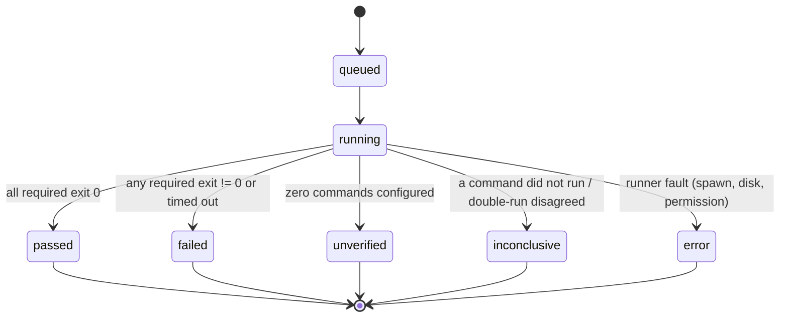

# 07 — Verification

Status: specification. Verification is the only operation in the product that executes project
code, so it is also the only operation whose security posture needs explicit honesty
(doc `09` §7).

---

## 1. What verification is and is not

| It is | It is not |
|---|---|
| Execution of the project's own declared commands on a specific candidate SHA | A sandbox |
| A record of exit codes, durations, and output digests | A correctness proof |
| A five-state result with explicit `not_verified` gaps | A green badge |
| Reproducible given (SHA, config, environment fingerprint) | Portable across environments in the sense of "same result guaranteed" |

`INV-5`: only a fully-passed required pipeline is rendered `passed`. Everything else has a
name, and the names are load-bearing.

---

## 2. The five outcomes



| Outcome | Exit | Blocking | Typical cause | What the report says |
|---|---|---|---|---|
| `passed` | 0 | no | all required green | "these checks passed on this SHA" |
| `failed` | 1 | yes | exit ≠ 0, timeout | the failing command + evidence |
| `unverified` | 4 | yes | no commands configured | "no checks ran; confidence low" |
| `inconclusive` | 1 | yes | spawn error, skipped-prerequisite, flaky | "could not determine" |
| `error` | 2 | yes | runner bug / disk full | "the runner failed; result invalid" |

The distinction between `failed` and `inconclusive` matters: a failing test means the code is
wrong; a spawn failure means we do not know. Collapsing them is how tools produce confident
nonsense.

### 2.1 Skip semantics

A command may be skipped only for a declared reason, and every skip is recorded:

| Skip reason | Result |
|---|---|
| `no_commands_configured` | run → `unverified` |
| `prerequisite_failed` (declared `needs:`) | command `skipped`, run → `inconclusive` |
| `advisory` (`required: false`) | command `skipped`/`failed`, run unaffected |
| `budget_exceeded` (total wall clock) | remaining commands `skipped`, run → `inconclusive` |

There is no `--skip-check` flag. The equivalent is editing `ilvuno.toml`, which is a committed,
reviewable change — exactly the property Marco wants (product `03` §2).

---

## 3. Execution model

```
for each spec in pipeline (sequential unless parallel declared):
   1. resolve cwd = <worktree>/<spec.cwd>; assert it is inside the worktree     [INV-12]
   2. build env = allowlist ⊕ spec.env_allow                                    [§4]
   3. spawn: sh -c <spec.run>, cwd, env, stdin=/dev/null, stdout/stderr → temp files
   4. supervise: process group; timeout from spec.timeout
   5. on timeout: SIGTERM group → 5s → SIGKILL group; status = timed_out
   6. capture: exit, signal, duration, sizes; redact; digest
   7. append EvidenceRecord(kind=command)                                        [doc 08 §5]
```

Why `sh -c` and not `execve(argv)`: users write `pnpm -s test --filter checkout`, which needs a
shell for globs, pipes, and `&&`. The exact string is recorded verbatim and the resulting
`argv`/`pid` are recorded, so the report shows what actually ran. On Windows (v0.2) this becomes
`cmd /c` / PowerShell — a documented divergence, not a silent one.

### 3.1 Process supervision

| Aspect | Decision | Reason |
|---|---|---|
| Group | `Setpgid: true`, kill `-pgid` | child processes of a test runner must die with it, or a timeout leaves orphans |
| Timeout | per command, default 900 s, config max 3600 s | protects the loop; a hung `pnpm` is common |
| Escalation | TERM → 5 s → KILL | matches common practice; recorded which rung |
| Output | streamed to temp files, not memory | a runaway logger must not OOM the CLI |
| Output cap | 64 MiB per stream, then truncate and mark `truncated` | bounded evidence |
| Exit detection | `WaitStatus` (exit code or signal) | a signal-killed command is not exit 0 |
| Orphan check | after the run, list children of our pgid; if any survive, kill and record | defence in depth |

### 3.2 Parallelism

Default sequential. Parallel only for commands that declare `parallel_group` and where no
ordering dependency exists:

```
[{name:"typecheck", run:"pnpm -s typecheck", parallel_group:"static"},
 {name:"lint",      run:"pnpm -s lint",      parallel_group:"static"},
 {name:"test",      run:"pnpm -s test"}]
```

Sequential default reasons: ordering-sensitive suites, interleaved logs that are unreadable,
and memory spikes from concurrent JS builds. Parallel across groups is not implemented in v0.1
(only within a group), which keeps the evidence model simple: one record per command, no
interleaving.

---

## 4. Environment

```
base allowlist:
  PATH, HOME, TMPDIR, TZ, LANG, LC_ALL, TERM=dumb,
  CI=true, ILVUNO=1, ILVUNO_RUN_ID, ILVUNO_CANDIDATE_SHA
plus spec.env_allow entries: name or name-from-config-value
```

Rules:

| Rule | Reason |
|---|---|
| Deny by default | an ambient `ANTHROPIC_API_KEY`, `NPM_TOKEN`, `AWS_*` must not reach a test runner by accident (`INT-305`) |
| Denied-name list takes precedence over allow | accidental `env_allow=["*_TOKEN"]` is refused at config validation |
| Never pass provider credentials we did not create | `AUTH-1` in doc `03` §3 |
| Values are never logged or stored | `INV-13`; the fingerprint stores **names and hashes**, not values |
| `TERM=dumb`, `CI=true` | deterministic output, no TTY-dependent behaviour (`INT-307`) |
| `ILVUNO_*` variables | lets a project adapt its own checks to being run under integration |

`HOME` is passed through deliberately: most toolchains need it (`~/.cache`, `~/.cargo`). That
also means a check can write outside the worktree, which is allowed and recorded, not blocked
(doc `05` §9).

---

## 5. Evidence capture

Per command, one `EvidenceRecord` plus up to two blobs:

```json
{"id":"evd_a1","seq":12,"kind":"command","at":"2026-11-19T14:02:31.412Z",
 "subject":{"candidate_sha":"9f2c...","command":"test"},
 "status":"failed",
 "data":{"argv":["sh","-c","pnpm -s test --filter checkout"],
         "cwd":"packages/checkout","exit":1,"signal":null,"duration_ms":18432,
         "advisory":false,"skipped_reason":null,
         "env_fingerprint":{"names":["PATH","HOME","CI"],"hash":"sha256:..."},
         "stdout_bytes":8123,"stderr_bytes":20144,"truncated":false,
         "out_digest":"sha256:..."},
 "blob":{"path":"logs/12-test.log","sha256":"sha256:...","bytes":28267},
 "prev_digest":"sha256:...","digest":"sha256:..."}
```

Redaction happens **at write time** (`INV-13`, doc `09` §6), not at export. Reasons: logs get
pasted into issues and chats long before anyone exports a bundle; and storing raw secrets with
"we'll redact later" is how leaks happen.

Redaction classes: known secret patterns (provider key prefixes, JWTs, private keys, common
`*_TOKEN=`, high-entropy strings above a threshold within assignments), plus `spec.redact`
regexes. A redacted span becomes `«redacted:<class>»` so evidence of redaction survives while the
value does not.

---

## 6. Candidate integrity during verification

Two checks bracket the pipeline:

```
tree_before = rev_parse(HEAD^{tree})   + status --porcelain (tracked changes only)
... run commands ...
tree_after  = rev_parse(HEAD^{tree})   + status --porcelain
head_after  = rev_parse(HEAD)
```

| Observation | Verdict |
|---|---|
| `head_after != candidate_sha` | **fail the run**: a command committed under the candidate (`candidate_mutated`). Evidence is retained; the result is not attributable to the approved SHA |
| tree unchanged, no tracked changes | normal |
| new untracked files | recorded as `outputs` (path list, capped); not a failure |
| tracked files modified | warning `worktree_dirty_after_verify` with the file list; evidence stays bound to `candidate_sha` |
| tracked files deleted | warning, same |

Rationale for allowing tracked modification: codegen, formatters, and snapshot updates commonly
write during tests. Failing on that would make the tool unusable. But the report must say the
tree drifted, because "we verified SHA X" while files changed underneath is exactly the kind of
quiet misstatement the product exists to remove.

---

## 7. Flakiness and repeat runs

`--runs N` (default 1) re-executes the pipeline N times on the same candidate:

| Pattern | Classification |
|---|---|
| all N passed | `passed` (with `runs: N`) |
| all N failed identically | `failed` |
| mixed | `failed` + `flaky_check` warning naming the command |

Flakiness is recorded, never used to turn a failure into a pass. A flaky required check blocks
approval — with the diagnosis attached, which is more useful than a retry that hides it
(`VER-104`).

---

## 8. Cost and wall-clock control

| Control | Default | Behaviour |
|---|---|---|
| Per-command timeout | 900 s | kill group, `timed_out` |
| Total pipeline timeout | 3600 s | remaining commands `skipped`, `inconclusive` |
| Output cap | 64 MiB/stream | truncate + flag |
| Evidence cap | 512 MiB/bundle | refuse seal, `error` |
| Progress | stderr, one line per stage | no TTY required (`INT-307`) |
| Signal handling | SIGINT → TERM group → record `interrupted` | resumable (doc `08` §4) |

The product metric `M-4` (time to verified candidate, p50 ≤ 5 min) excludes command execution,
so our own overhead is what this section protects. `ilvuno stats` shows the user the split
("engine: 3.8 s, your checks: 9m 41s") so the number is never ambiguous.

---

## 9. Failure scenarios

| Scenario | Detection | Result |
|---|---|---|
| Command not found | exit 127 | `failed` (not `error`): the project's environment is broken, and the exit code says so |
| Command killed by OOM | signal 9 | `failed` with `signal: 9` and a hint |
| Command writes 10 GiB to stdout | output cap | truncate, `truncated: true`, run continues |
| Command hangs forever | timeout | kill group, `timed_out` |
| Command spawns a daemon that survives | pgid scan after run | kill, record `orphan_killed` |
| Runner cannot create temp files | `error` | `evidence_write_failed` |
| Two commands write the same log file | per-command stdout files keyed by seq | no collision possible |
| Command exits 0 but the suite clearly failed (agent-authored runner) | undetectable | documented limitation: we trust exit codes. That is the same contract CI uses, and pretending otherwise would be a false claim |
| Config lists a command needing a TTY | `TERM=dumb`, no TTY | the command must handle it; otherwise it fails, visibly |
| Candidate worktree disappears mid-pipeline | cwd missing | `error` with `worktree_drift` |

---

## 10. Config schema (`ilvuno.toml`, normative subset)

```toml
[project]
base = "main"

[verification]
total_timeout = "3600s"
runs = 1

[[verification.commands]]
name = "typecheck"
run = "pnpm -s typecheck"
cwd = "."
timeout = "300s"
required = true

[[verification.commands]]
name = "test"
run = "pnpm -s test"
timeout = "900s"
required = true
env_allow = ["DATABASE_URL_TEST"]
redact = ["sk_live_[A-Za-z0-9]+"]

[[verification.commands]]
name = "lint"
run = "pnpm -s lint"
required = false
parallel_group = "static"

[analysis]
dependency_manifests = ["package.json", "pnpm-lock.yaml"]
hunk_proximity = false
index_command = ""

[limits]
max_sources = 16
max_candidate_files = 100000
drift_threshold = 50

[repair]
command = "claude -p"        # any executable; Ilvuno embeds no agent
budget = 2
```

Validation rules (fail closed at load): unknown keys rejected; `required` defaults **true**;
`budget ≤ 5`; timeouts must be explicit if > 900 s; `env_allow` entries matching the denied list
are refused; a config with no commands loads fine but `init`/`doctor` must warn loudly
(`INT-310`).

---

## 11. Open questions

| ID | Question | Recommendation |
|---|---|---|
| `VR-1` | Should a repo be able to declare "no tests" honestly and get something better than `unverified`? | No. Inventing a weaker "static-only" pass state would dilute the five-state model |
| `VR-2` | Retry a timed-out check once automatically? | No: a timeout is a signal, and auto-retry doubles wall clock. `--runs` is explicit |
| `VR-3` | Parallel command groups in v0.1? | No: sequential evidence is simpler and the default pipeline is one test command |
| `VR-4` | Should we capture the command's environment hash including values? | No. Hash names only; a value hash is a brute-forceable oracle |
| `VR-5` | Streaming structured results (JUnit XML) into findings? | Post-MVP, and only as `deterministic` supplementary detail; exit code remains the verdict |
