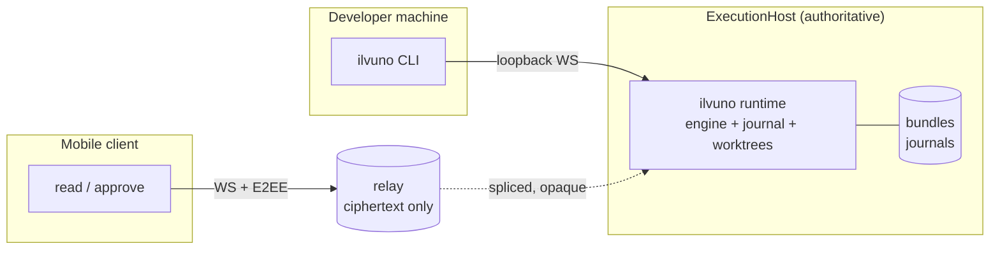

# 10 — Cross-Device Architecture (Future)

Status: **design only. No implementation until approved** (`XDC-1xx`, product `05` §5). This
document exists now because the MVP's formats are the wire formats of this design (doc `01` §4),
and because three decisions below constrain the MVP today.

---

## 1. What is being designed, and what is refused

Goal: a developer can start an integration on a laptop, watch it from a phone, approve it from
the phone, and see the same task history on another machine — without the core becoming a
service.

| Capability | Designed | Refused |
|---|---|---|
| Same task view on N devices | yes — Passport + bundles are transport-free | — |
| Watch a live run remotely | yes — event replay over a socket | live process migration |
| Approve remotely | yes — device-signed approvals | approval without evidence verification |
| Run verification on a remote/always-on host | yes — ExecutionHost is already a first-class concept | moving a worktree between hosts |
| Full conversation continuity | **no** — never claimed (`TSK-112`) | transcript sync, provider session portability |
| Offline mobile authoring | no | — |

The reason for the last refusal is evidence, not taste: native resume is provider- and
environment-bound (`ORC-022`, `CR-016`, `T3-009`), and cloudroom's own handoff moves the native
file exactly while leaving uncommitted tracked edits behind (`CR-021`). Promising more than that
would be the same overclaim the product exists to eliminate.

---

## 2. Topology



Principles:

1. **One authority per repository checkout.** The host that owns the worktrees owns the run. No
   dual-writer, no CRDT for git state.
2. **Clients are thin and stateless.** Every client renders from docs it fetched; no client-side
   DB is authoritative.
3. **The relay is a broker, not a proxy of trust.** It routes opaque frames and stores nothing
   but presence and queued ciphertext (the t3code model: relay allocates, does not proxy, `T3-054`).
4. **The MVP's file formats are the protocol.** A remote client fetches
   `report.json`/`passport.yaml`/`manifest.json`; the live stream is the same journal records.

---

## 3. Pairing and authentication

### 3.1 Pairing (one device at a time)

```
1. host: ilvuno pair            → prints a code + QR containing
                                  {host_id, host_pub (Ed25519), code_hash, expires_at, nonce}
2. device: scans, generates device keypair, sends
                                  {code, device_pub, device_label, proof=Sign(device_priv, nonce)}
3. host: verifies code (single-use, 5 min TTL), stores device_pub in its device registry,
         returns a device token bound to the device key (DPoP-style)
4. both sides display the same 6-word fingerprint derived from
         sha256(host_pub || device_pub) → user confirms on the host
```

Properties, each mapped to an anti-pattern it avoids:

| Property | Avoids |
|---|---|
| Single-use, short-TTL code | replay of a screenshot |
| Explicit fingerprint confirmation on the host | silent trust-on-first-use (`ORC-073`) |
| Per-request proof of possession (DPoP), not just a bearer token | token replay on a shared network |
| Device key stored in the OS keystore, `WHEN_UNLOCKED_THIS_DEVICE_ONLY` | extractable tokens (`ORC-071` is the prior art to copy) |
| Constant-time comparison everywhere | timing oracles (`ORC-072`) |
| Exactly one protocol version, no legacy fallback | downgrade to a weaker handshake (`ORC-067`) |

### 3.2 Scopes

Sessions carry explicit scopes; the device gets a subset, never "everything":

| Scope | Grants |
|---|---|
| `read:task` | fetch passports, reports, bundles |
| `read:stream` | subscribe to live journal events |
| `approve` | create approvals (requires evidence verification locally on the host) |
| `operate` | trigger `integrate`/`repair` (opt-in; off by default for phones) |
| `admin` | pair/revoke devices (host only, never remote) |

`approve` without `read:task` is invalid (you cannot approve what you cannot see), and `operate`
requires an explicit per-device toggle — the t3code lesson that a broad default pairing grant
effectively becomes full authority (`T3-056`). Binding a mobile pairing to the ability to start
shell-capable repairs is exactly the mistake to avoid.

---

## 4. The authoritative runtime

When the daemon arrives, it is the same code as the CLI with three additions:

| Addition | Reason | Constraint |
|---|---|---|
| Socket listener | clients need a transport | loopback only unless paired; never `0.0.0.0` by default (the `T3-053` "this is not a firewall" honesty) |
| Subscription fan-out | live events | per-subscription backpressure; a slow client is dropped, never blocks the engine |
| Durable run queue | multiple producers | admission control required; this is where a persistent queue becomes justified (ADR-0002 revisit) |

Non-additions, deliberately: the daemon does **not** own agent processes in MVP-Plus-1, and does
not become the source of truth for tasks. The journal and passports remain the truth; the daemon
is a server over files.

### 4.1 Execution-host ownership

| Rule | Consequence |
|---|---|
| A worktree belongs to exactly one host, permanently | no migration primitive exists |
| A run belongs to one host | evidence is portable; the run is not |
| A task may span hosts | the passport references SHA + bundle digests, which are host-independent |
| A host is identified by a random `hst_*`, not a hostname | no machine identity leaks into shared artifacts (`INV-9`) |
| Removing a host requires an explicit `host forget` that lists affected runs | prevents silent orphaning |

Cross-host task view is the interesting case, and it already works in the MVP's data model: two
machines with the same repo and fetched refs can each run integrations, and the passport shows
both because it keys on SHAs and bundle digests, not on run ids of a particular host.

---

## 5. Task and session continuity

| Layer | Travels? | Mechanism |
|---|---|---|
| Task objective, criteria, decisions | yes | passport file (git) |
| Stream SHAs, candidate SHAs | yes | git objects (fetch) |
| Verification results | yes | bundles (content-addressed, digest-linked) |
| Approvals | yes | signed records; verify offline |
| Live process state | no | host-bound |
| Provider session / transcript | **no** | provider-bound (`PSN-*`), never claimed |
| In-flight journal | no | host-local; a foreign journal is readable but not resumable (doc `08` §10) |

This is the "task persistence ≠ conversation migration" line from the PRD, expressed as a table
that an implementer cannot misread.

---

## 6. Event replay and connection recovery

### 6.1 Stream protocol

```
subscribe(run_id, after_seq) →  frames: {seq, record} …
                                control: {snapshot_required, last_seq}
                                control: {heartbeat, t}
```

| Client state | Server response |
|---|---|
| `after_seq` within retained journal | replay records; then live |
| gap exceeds bounds (bytes or count) | `snapshot_required` → client fetches `report.json` + recent records and resumes from `last_seq` |
| journal pruned beyond `after_seq` | `snapshot_required` with `history_partial: true` |
| reconnect after network drop | resume from last seen `seq` (idempotent: records are immutable) |
| duplicate frames after reconnect | client dedups by `seq` (records carry `seq`, not a clock) |

`seq`-based replay is why the MVP insists on contiguous per-run sequence numbers (doc `08` §3.1):
it makes replay trivial and makes corruption detectable, with no vector clocks or ordering
metadata.

### 6.2 Reconnection policy

| Behaviour | Value | Rationale |
|---|---|---|
| Backoff | jittered exponential, cap 60 s | mobile networks flap; t3code's 5-min cap (`T3-023`) is too slow for an approval flow |
| Liveness probe | on foreground + every 20 s while visible | phone radios suspend |
| Re-auth | proof-of-possession per request; token refresh before expiry | no long-lived bearer |
| Failure UX | "last updated <time>" on every view, never a stale view pretending to be live | the honest-UI rule |
| Run continues during client outage | always | a client disconnect never stops work (`CR-015`) |

---

## 7. Remote approval

The flow, with the security-relevant steps made explicit:

```
phone: GET /runs/<id>/approval-request
   → {candidate_sha, evidence_digest, checks[], not_verified[], findings[deterministic]}
phone: verify locally? (optional but recommended)
   → fetch manifest + files, recompute digests, compare to evidence_digest
phone: POST /approvals  body={sha, evidence_digest, scope, decision}
   signed with device key, proof-of-possession header
host:  verify signature, verify device scope has `approve`, verify device not revoked,
       verify evidence_digest still resolves and verifies,
       verify sha == current candidate sha,
       then write the approval record locally  ← the host is still the author of record
```

| Rule | Reason |
|---|---|
| The **host** writes the approval; the phone requests it | one authority, and the local record stays the authoritative one |
| The host re-verifies the bundle | a compromised client cannot approve unverified evidence |
| `sha == current candidate` | prevents approving a candidate that changed since the request was shown |
| Device revocation is checked at approval time, not just at connect | revocation must take effect immediately |
| Approval shows `via: device <label>` | auditability; a reviewer can see it was remote |

Device revocation: `ilvuno device revoke <id>` writes to the device registry (host-local),
invalidates sessions, and appends a journal note. Any approval created by a revoked device after
revocation is refused; approvals created before remain valid but are marked
`created_before_revocation` so an auditor can evaluate them.

---

## 8. Transport and encryption

| Hop | Protection |
|---|---|
| Client ↔ host on loopback | bearer-token-equivalent + OS permissions; no TLS needed (same machine) |
| Client ↔ host on LAN | E2EE handshake (X25519 + AEAD), plus DPoP-bound sessions; **never** plaintext WS |
| Client ↔ relay | E2EE to the host's key; the relay sees ciphertext and routing metadata only |
| Relay ↔ host | outbound WebSocket from the host (no inbound port required), as in `T3-054`/`ORC-069` |
| Metadata minimisation | relay sees `{host_token, frame_size, timing}` — no repo names, no paths, no SHAs (`SEC-107`) |

Explicit non-goals: no custom crypto primitives (use standard AEAD + X25519 + Ed25519), no
version negotiation that permits weaker suites, no "compatibility mode".

---

## 9. What must be built before any of this ships

| Prerequisite | Why | Exists? |
|---|---|---|
| Stable report/passport/bundle schemas | the wire format | yes (ADR-0014) |
| Contiguous `seq` + immutable records | replay | yes |
| Digest-bound approvals | remote approval integrity | yes (local) |
| Device key storage plan per OS | keystore use | no |
| Threat model review of the relay | new network surface | no (`SEC-105`) |
| Threat model review of `operate` scope | remote code execution by design | no |
| Multi-host lock semantics | two hosts, one repo | no (doc `04` §3.1 refuses today) |
| A verdict on hosted economics | does anyone pay (product `06` T1–T2) | no |

The last row matters most: nothing here is built until the paid hypothesis is tested. Designed
now, built later, is the discipline (product `A-10`, gate G4→G5).

---

## 10. Failure scenarios (design-level)

| Scenario | Behaviour |
|---|---|
| Phone offline mid-approval | approval is not queued locally on the phone to "send later"; the request is re-fetched, and a changed candidate invalidates it |
| Host offline | clients show last-known state with a timestamp; no writes accepted |
| Relay compromise | ciphertext only; relay cannot forge approvals (signed) or read evidence |
| Device lost | `device revoke` immediately stops new approvals; existing ones marked for audit |
| Replay of an approval frame | DPoP nonce + monotonic request counter + host-side dedup by approval id |
| Host clock skew | approval timestamps are advisory; the host records its own `at` |
| Two phones approve concurrently | first wins; second gets `already_approved` with the same approval id (idempotent by `(sha, evidence_digest, scope)`) |
| A `read:task` device tries `operate` | refused by scope check, logged |
| Paired device presents an old token after revocation | refused; session dropped; alert in `doctor` |

---

## 11. Open questions

| ID | Question | Recommendation |
|---|---|---|
| `XD-1` | Is a daemon required at all, or can file sync + a relay of notifications suffice? | Start with file sync (rung 2); a daemon only when live streaming is demanded by a paying cohort |
| `XD-2` | One relay or bring-your-own (Tailscale-style)? | Bring-your-own first (zero infrastructure), managed relay only if paid (H1) |
| `XD-3` | Should `operate` ever be allowed from a phone? | No in v1. Approving is a decision; triggering a shell-capable run from a phone is an incident vector |
| `XD-4` | Team multi-user on one host | Post-MVP; requires signed approvals mandatory (`SC-3`) and an identity story we do not have |
| `XD-5` | How do we test the E2EE path deterministically? | Recorded frame fixtures + a conformance harness with a fake relay (doc `11` §8) |
