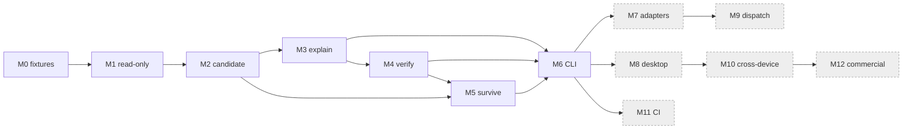

# 03 — Dependency Graph

Status: planning artifact. Task IDs resolve to `docs/tasks/`. Milestones to
`02-milestones.md`.

---

## 1. Milestone DAG



Hard edges (a milestone cannot start without the predecessor's gate):

| Edge | Why it is hard |
|---|---|
| M0 → M1 | every later test uses the forge |
| M1 → M2 | candidate construction needs pinned SHAs and refusals |
| M2 → M3 | findings attach to a candidate; there is nothing to explain without one |
| M3 → M4 | verification records go into the evidence store built in M3 |
| M4 → M5 | you cannot test crash recovery of a pipeline that does not exist |
| M4 → M6 | the CLI's main value is verification output |
| M5 → M6 | public release requires defensible recovery (G5) |

Soft edges (can overlap by days, not by milestone):

| Overlap | Condition |
|---|---|
| M2 journal + M1 config | both are independent packages; the journal does not need config |
| M3 analysis + M2 candidate | analysis reads pinned SHAs; it can be built against fixtures before the candidate exists |
| M5 crash harness + M4 runner | the harness needs the runner, but `testhooks` plumbing can land first |

---

## 2. Task DAG (critical path bold)

```
T-0001 ─┬─ T-0002 ─┬─ **T-0003** ─┬─ **T-0005** ── M0 gate
        │          └─ T-0004 ─────┘
        │
T-0002 ──┴─ T-0101 ── **T-0102** ── T-0103
                       │
                       └─ **T-0104** ── T-0105 ── M1 gate
                              │
                 ┌────────────┴───────────┐
                 ▼                        ▼
            **T-0201** journal      T-0202 policy+wt
                 │                        │
                 └────────┬───────────────┘
                          ▼
                    **T-0203** determinism ── **T-0204** preflight
                          │                        │
                          └──────┬─────────────────┘
                                 ▼
                        **T-0205** candidate ── M2 gate
                                 │
              ┌──────────────────┼──────────────────┐
              ▼                  ▼                  ▼
        T-0301 model       T-0302 analysis    T-0304 evidence
              │                  │                  │
              └───────┬──────────┘                  │
                      ▼                             │
                T-0303 deps/iface                   │
                      │                             │
                      └──────────┬──────────────────┘
                                 ▼
                        **T-0305** report ── M3 gate
                                 │
                                 ▼
                    **T-0401** runner+env+supervision
                                 │
                     ┌───────────┴───────────┐
                     ▼                       ▼
              T-0402 states/evidence   T-0403 combination-only
                     │                       │
                     └──────────┬────────────┘
                                ▼
                        T-0404 verify cmd ── M4 gate
                                │
                    ┌───────────┴────────────┐
                    ▼                        ▼
             **T-0501** resume          T-0502 lock/idem
                    │                        │
                    └──────────┬─────────────┘
                               ▼
                      **T-0503** crash matrix
                               │
                               ▼
                      T-0504 corruption+cleanup ── M5 gate
                               │
              ┌────────────────┼────────────────┬──────────────┐
              ▼                ▼                ▼              ▼
        T-0601 passport   T-0602 approval  T-0603 repair  T-0604 CLI/docs
              └────────────────┴────────────────┴──────────────┘
                               ▼
                      **T-0605** release ── M6 gate
```

Bold = on the critical path. Everything else can slip one day without moving the gate.

---

## 3. Critical path

```
T-0001 → T-0002 → T-0003 → T-0005 → T-0101 → T-0102 → T-0104 →
T-0201 → T-0203 → T-0204 → T-0205 → T-0301 → T-0305 → T-0401 →
T-0403 → T-0404 → T-0501 → T-0503 → T-0601 → T-0605
```

| Property | Value |
|---|---|
| Length | 21 tasks |
| Estimated | 10.5 weeks of the 13 |
| Float elsewhere | ~2.5 weeks (parallel branches) |
| Single points of failure | `T-0002` (forge), `T-0204` (preflight), `T-0501` (resume) |

The three single points are exactly the falsification experiments (E-1, E-3, E-4). That is
intentional: if the plan is wrong, it should be wrong early and on the critical path.

---

## 4. Parallel waves (for 2 coding agents)

Constraint: **one owner per package per wave**. Shared packages (`model`, `policy`, `cli`) have a
fixed owner.

| Wave | Weeks | Agent A (engine/git) | Agent B (analysis/evidence) | Shared-file risk |
|---|---|---|---|---|
| W1 | 1 | `T-0001`, `T-0002`, `T-0004` | `T-0003` (fixtures) | low — different packages |
| W2 | 2 | `T-0101`, `T-0102` | `T-0103` | low |
| W3 | 3 | `T-0104`, `T-0105` | `T-0201` (journal) | `model` not yet created |
| W4 | 4–5 | `T-0202`, `T-0203` | `T-0204` | **medium** — both touch `gitx` |
| W5 | 6 | `T-0205` | `T-0301` | medium — `model` introduced by B |
| W6 | 7 | `T-0305` (report) | `T-0302`, `T-0303` | low |
| W7 | 8 | `T-0304` (evidence) | `T-0401` (runner) | low |
| W8 | 9 | `T-0402`, `T-0403` | `T-0404` | medium — `verify` package |
| W9 | 10–11 | `T-0501`, `T-0503` | `T-0502`, `T-0504` | low |
| W10 | 12 | `T-0601`, `T-0602` | `T-0603`, `T-0604` | low |
| W11 | 13 | `T-0605` (release, both agents) | — | low |

Waves W4 and W8 are the only places where two agents touch the same package. Policy for those
(see `02-milestones.md` §11): the package owner
is the agent who created the file; the other agent submits a patch and requests the change, and the
owner applies it. That is slower than both editing, and it is the reason 2 agents ≈ 1.7×, not 2×.

---

## 5. Package ownership map

| Package | Path | Owner | Others may |
|---|---|---|---|
| CLI | `internal/cli`, `cmd/ilvuno` | A | read, propose |
| Model | `internal/model` | B (from W5) | read only |
| Git | `internal/gitx` | A | read only |
| Engine | `internal/engine` | A | read only |
| Analyze | `internal/analyze` | B | read only |
| Verify | `internal/verify` | B (from W7) | read only |
| Evidence | `internal/evidence` | B | read only |
| Passport | `internal/passport` | A (from W10) | read only |
| Policy | `internal/policy` | A | read only |
| Proc | `internal/proc` | B | read only |
| Redact | `internal/redact` | B | read only |
| Testkit | `internal/testkit/*` | shared, additive only | both add files, never edit each other's |
| Schemas | `schemas/*` | B | additive; breaking change needs review |
| Docs | `docs/**` | per-task author | both |

Rule: a package has exactly one owner *at any time*, and ownership transfers are announced in the
wave plan. Conflicting ownership is what produces merge conflicts that look like design conflicts.

---

## 6. Dependency rules that the build enforces

```
cli      → engine, passport, evidence, cli/output
engine   → gitx, analyze, verify, evidence, model, policy, proc
analyze  → gitx, model
verify   → proc, evidence, model, policy
evidence → model, redact
passport → model, evidence
policy   → (stdlib)
model    → (stdlib)
gitx     → policy, model
agent    → model, policy          (post-MVP; NOT imported by engine)
testkit  → gitx (test-only)
```

Enforcement: a `go vet`-style analyzer test that fails the build on a forbidden import
(`T-0001` includes the harness; the rule itself is asserted from `T-0301` when packages multiply).

---

## 7. External dependencies and their dates

| Dependency | Needed by | Action |
|---|---|---|
| git ≥ 2.38 on dev + CI | M0 (B-3) | pin the CI image; `doctor` probe |
| Go toolchain (latest stable) | M0 | pin in `go.mod` + CI |
| GitHub Actions (linux/macOS runners) | M0 | free tier sufficient |
| No runtime deps | permanently | ADR-0001/0002 |
| Signing key for releases (optional) | M6 | decide at release, not before |

There are no service dependencies, no API keys, and no database. That is a property of the design,
and it should stay visible in the plan: a 15-week schedule with zero external approvals is the
reason the schedule is credible.

---

## 8. Slip analysis

| If this slips | Impact on gate date | Mitigation |
|---|---|---|
| `T-0002` forge (1 day) | +1 day, everything | none — it is the foundation; treat as fixed |
| `T-0204` preflight (2 days) | M2 +2 days, M4 unaffected | findings demote to warnings (E-3 negative path) |
| `T-0501` resume (3 days) | M6 +3 days | ship v0.1 with `abort`+re-run only, explicitly documented |
| `T-0403` combination-only (3 days) | M6 +3 days | ship with `combination_only: unknown`; measurement deferred (but this weakens the product claim) |
| Anything in M6 docs | gate date | docs and code ship together; no "docs later" |

The two "ship without" options are enumerated in advance so that, if they are taken, they are
decisions rather than accidents. Both carry a visible product cost and both are recorded in the
release notes.
