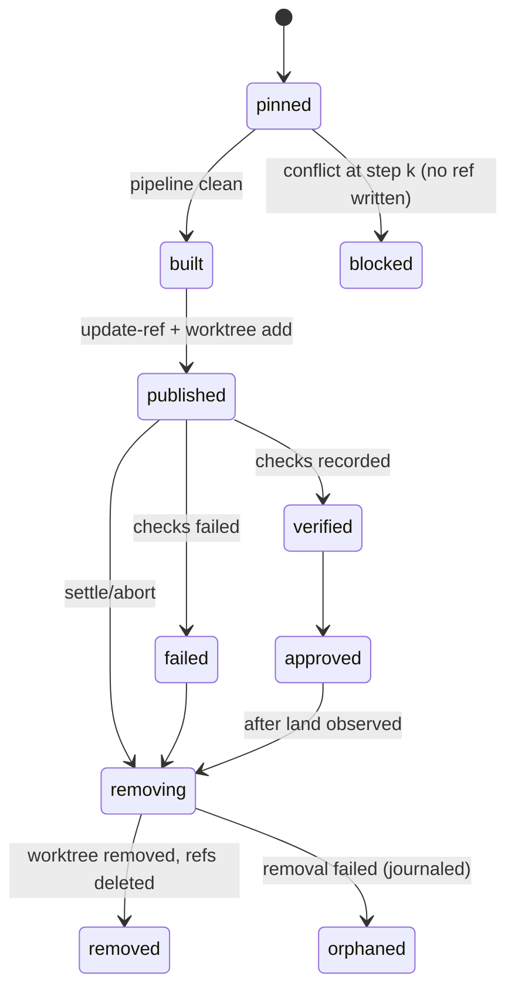

# 02 — Git Integration Correction

Status: engineering proposal with verified experiments. **No approved document modified.**
All experiments ran in throwaway repositories under `/tmp` with `GIT_CONFIG_GLOBAL=/dev/null`
and `GIT_CONFIG_SYSTEM=/dev/null`. The user's repository was never used as a fixture.

---

## 1. Three defects, one root cause

| Defect | Review ID | Root cause |
|---|---|---|
| A 3+-ref `merge-tree` call that does not exist | BLK-01 | The design assumed a merge primitive that accepts a set, because it wanted to *predict* an N-step result in one call |
| `worktree add -B refs/ilvuno/…` cannot create that ref | HI-01 | The design assumed a branch name and a custom ref are interchangeable |
| "No mutation before preflight" is unusable once objects and drivers are counted | HI-02, HI-03 | The design treated "object database" as "not really a write" and ignored configured merge drivers |

The root cause is the same in all three: the design *predicted* a sequential operation with a
single-call approximation and then described the approximation as if it were the operation.

**Correction: stop predicting. Perform the sequential operation in the object database, where it
is cheap, atomic per step, and has no index or working tree.** Prediction and construction become
one computation, which removes the entire class of prediction-vs-reality divergence.

---

## 2. Verified Git behaviour

Local Git: `2.55.0`. Every claim below was executed; transcripts are abridged but exact where
quoted.

| ID | Question | Result |
|---|---|---|
| **X-01** | What is the supported `merge-tree` shape? | `usage: git merge-tree [--write-tree] [<options>] <branch1> <branch2>`; also `--stdin  perform multiple merges, one per line of input`; `--[no-]merge-base <tree-ish>`; `-z`, `--name-only`, `--no-messages`, `-X` |
| **X-02** | Does it accept 3 commits? | `git merge-tree --write-tree A B C` → usage text, **exit 129**. BLK-01 confirmed. |
| **X-02b** | Output shape for machines? | `--write-tree --name-only -z --no-messages` → `<tree-oid>\0`, then one `<path>\0` per conflicted path. Clean: `<tree-oid>\0`, exit 0. Conflict: same prefix + paths, **exit 1**. Unrelated histories: no stdout, `fatal: refusing to merge unrelated histories` on stderr, **exit 128**. |
| **X-03** | Does the object pipeline match real sequential merges? | 3 sources, all clean: object-pipeline final tree `3d0ab6dc…` == real `git merge --no-ff` ×3 tree `3d0ab6dc…`. With identical message and committer envelope, the **commit SHA also matched**: `725afea8…` both sides. |
| **X-03b** | Is it deterministic? | Two consecutive pipeline runs → same commit `d2367bb4…`. |
| **X-04** | What does `worktree add -B refs/ilvuno/candidates/probe` create? | **`refs/heads/refs/ilvuno/candidates/probe`** — a branch literally named `refs/ilvuno/…`. `git for-each-ref refs/ilvuno` matched nothing. HI-01 confirmed. |
| **X-04b** | Does `worktree add --detach` + `update-ref` work? | Worktree listed as `detached`; `refs/ilvuno/candidates/probe4 15cdc33` present; cleanup (`worktree remove --force` then `update-ref -d`) left no residual ref and no worktree entry. |
| **X-05** | Does `merge-tree` execute custom merge drivers? | **Yes.** With `merge.upper.driver = sh -c 'touch /tmp/ilv2/DRIVER_RAN; …'` and `data.txt merge=upper` in `.gitattributes`, `git merge-tree --write-tree` exited 0 **and created `/tmp/ilv2/DRIVER_RAN` outside the repository**. Real merge did the same. HI-03 confirmed. |
| **X-06** | What does each operation write inside `.git`? | `merge-tree` → loose objects only (`objects/47/5bc313…`). `worktree add` → `.git/worktrees/<n>/{commondir,gitdir,HEAD,index,logs/HEAD,ORIG_HEAD}`. `merge` in a worktree → objects + that worktree's `HEAD`, `index`, `logs/HEAD`. Object count 30→32 on a conflicting merge (objects are written even when conflicts occur). |
| **X-07** | Can a lost candidate be recreated? | Yes: the pipeline is a pure function of pinned SHAs + envelope; recomputation produced the identical SHA. |
| **X-08** | Pair-clean / tuple-conflict fixtures exist? | **Not reproduced.** 60 randomized 3-branch trials (7 with all three pairs clean) → 0 tuple conflicts. 4 targeted constructions (rename+modify, add/add identical content, mode change, `.gitattributes` change) → all clean at every step. |
| **X-09** | Is all of this true on the Git floor (2.38)? | **Not yet verified.** No 2.38 binary available here. Unresolved — see §9. |
| **X-10** | Does `check-attr --source=<tree>` exist? | Yes on 2.55 (`--source <tree-ish>`), which enables driver detection against a tree without materializing it. Version availability unknown on the floor → capability-probe with a conservative fallback. |

---

## 3. Corrected algorithm

### 3.1 Phases

```
P0  CLAMP     resolve refs → immutable SHAs, refuse unusable inputs
P1  ORDER     deterministic total order, skip already-integrated sources
P2  GATE      refuse custom merge drivers unless consented; fingerprint config
P3  BUILD     sequential two-way merges in the object database (no worktree, no index)
P4  PUBLISH   write refs/ilvuno/candidates/<run>; materialize a detached worktree
P5  VERIFY    run the configured checks in that worktree
P6  CLEANUP   archive patch if dirty → remove worktree → delete ref → prune
```

P3 does not touch the index or any working tree. P4 is the first operation that creates a
working tree, and it happens **after** the candidate exists, so a conflict never leaves a
half-materialized tree.

### 3.2 P0 — clamp

```sh
git rev-parse --verify "$base_ref^{commit}"
git rev-parse --verify "$src_ref^{commit}"        # or accept a 40-hex SHA directly
git cat-file -e "$sha"                            # object must exist locally
git merge-base --is-ancestor "$base_sha" "$sha"   # information only, not a refusal
```

Refusals (typed, exit 2): `unpinnable_source`, `not_a_commit`, `source_equals_base`,
`duplicate_source`, `source_is_head_or_symbolic` (`HEAD`, `@{…}`, paths, `.ilvuno/**`),
`source_object_missing`.

### 3.3 P1 — order and skip

Order: ascending `commit_time` of the source, then manifest `order`, then SHA — a total order
that does not depend on input order or wall clock.

Before building, drop sources already contained in the accumulator:

```sh
git merge-base --is-ancestor "$src" "$accum"   # exit 0 → skip, reason "already_integrated"
```

Verified (X-03): a source already contained produces a no-op tree and would otherwise create an
empty merge commit.

### 3.4 P2 — gate

```sh
git config --get-regexp '^merge\..*\.driver$'      # non-builtin drivers, if any
git check-attr merge --source="$sha" -- <changed paths>   # when supported
git -c core.attributesFile=.git/info/attributes ...
```

Policy in §7. Also persist the config fingerprint (§8) into the journal **before** the first
object is written.

### 3.5 P3 — object pipeline (the corrected core)

For each source in order:

```sh
# 1. compute the merge tree for this step (two commits only — supported shape)
git -c core.hooksPath= -c commit.gpgsign=false -c merge.conflictStyle=merge \
    merge-tree --write-tree --name-only -z --no-messages "$accum" "$src"
#    exit 0 → stdout = "<tree>\0"
#    exit 1 → stdout = "<tree>\0<path>\0..." ; tree contains conflict markers — DISCARD IT
#    exit 128 → fatal (unrelated histories) → typed error

# 2. materialize the step as a commit (same machine, same envelope)
GIT_AUTHOR_NAME=ilvuno GIT_AUTHOR_EMAIL=ilvuno@localhost \
GIT_COMMITTER_NAME=ilvuno GIT_COMMITTER_EMAIL=ilvuno@localhost \
GIT_AUTHOR_DATE="$ENVELOPE_DATE" GIT_COMMITTER_DATE="$ENVELOPE_DATE" \
    git commit-tree "$tree" -p "$accum" -p "$src" -m "ilvuno: integrate ${src:0:12} (step i/n)"
#    exit 0 → stdout = new commit SHA ; accum = that SHA
```

`ENVELOPE_DATE` = the base commit's committer timestamp, UTC, truncated to seconds. The version
string is **not** in the message (it lives in `refs/ilvuno/meta/<run>`), so an Ilvuno upgrade does
not change the candidate SHA.

Recorded per step: `index`, `source_sha`, `pre_sha`, `post_sha`, `tree_sha`, `result`
(`clean|conflict|skipped|already_integrated`), `conflict_paths[]`, `driver_used`, `duration_ms`.

**On conflict (exit 1), by policy:**

| Policy | Behaviour |
|---|---|
| `stop` (default) | Record the step, do **not** commit the conflict tree, do **not** write the candidate ref, finish with exit 3. Objects for steps 1..k-1 remain and are reachable via the recorded `pre_sha`. |
| `continue` | Record `skipped(conflict)`, add the source to `excluded[]`, continue with the next source. Partial candidate is labelled as partial everywhere (`INT-109`). |

### 3.6 P4 — publish and materialize

```sh
git update-ref refs/ilvuno/candidates/<run_id> "$candidate_sha"
git worktree add --detach ".ilvuno/worktrees/<run_id>/candidate" "$candidate_sha"
git -C <worktree> rev-parse HEAD          # assert == candidate_sha
```

Also written: `refs/ilvuno/meta/<run_id>` → a blob containing versions and the config fingerprint
(not part of the commit).

Why detached: `-B` writes `refs/heads/…` (X-04). Why the ref at all: the invariant is "we only
write `refs/ilvuno/*`", and a detached worktree alone gives no ref to audit or recover from.

### 3.7 P6 — cleanup

```sh
git -C <worktree> diff --binary <base_sha> > .ilvuno/runs/<run>/candidate.patch   # if dirty
git worktree remove --force ".ilvuno/worktrees/<run_id>/candidate"
git update-ref -d refs/ilvuno/candidates/<run_id>
git update-ref -d refs/ilvuno/meta/<run_id>
git worktree prune
```

Order verified (X-04b): worktree first, ref second. Deleting the ref first also works, but keeping
the ref until the worktree is gone means a crash mid-cleanup leaves an auditable pair rather than a
orphan directory with no ref.

---

## 4. Input revision pinning

| Rule | Implementation |
|---|---|
| Every input is a commit SHA | `rev-parse --verify <x>^{commit}`, then never resolve the ref again |
| Refs are resolved exactly once | `Pin()` is the only resolver (ADR-0005 unchanged) |
| Moving refs cannot affect a run | all later commands take SHAs |
| Missing objects are refused early | `cat-file -e` at clamp time |
| The base is refreshed before pinning, or the run says it didn't | `fetch` unless `--offline`; `stale_base_accepted` recorded |
| Sources that are the base, duplicates, or the run's own candidate | refused at clamp |

---

## 5. Candidate ref strategy (replaces architecture 05 §4)

**PROPOSED replacement text** (to apply on approval):

> ### 4. Candidate ref and worktree
>
> A candidate is a commit plus two refs plus one optional worktree:
>
> | Object | Value |
> |---|---|
> | candidate commit | `refs/ilvuno/candidates/<run_id>` → the final merge commit |
> | run metadata | `refs/ilvuno/meta/<run_id>` → a blob with tool/git versions and the config fingerprint |
> | worktree | `.ilvuno/worktrees/<run_id>/candidate`, **detached** at the candidate commit |
>
> Creation is `git worktree add --detach <path> <sha>`, never `-B`. A branch name supplied to `-B`
> is stored under `refs/heads/` — including a branch literally named `refs/ilvuno/…` — so it
> cannot satisfy the namespace invariant.
>
> Worktree ownership is decided by **path prefix** (`.ilvuno/worktrees/`) plus the journal entry,
> because a detached worktree has no branch line in `git worktree list --porcelain`. Ref checks use
> an anchored prefix (`^refs/ilvuno/`), never a substring match: `refs/heads/refs/ilvuno/x` contains
> the substring and must not pass.

Lifecycle:



---

## 6. Git-internal side effects (measured)

| Operation | Writes inside `.git` | Writes outside |
|---|---|---|
| `fetch` | `FETCH_HEAD`, `objects/**`, `refs/remotes/**` (or packed-refs), possibly `gc.log` | network |
| `merge-tree --write-tree` | loose objects under `objects/xx/**` (even when conflicting) | **custom merge driver may write anywhere** (X-05) |
| `commit-tree` | one commit object | — |
| `update-ref refs/ilvuno/…` | `refs/ilvuno/**` (or `packed-refs` if the user packs) + `logs/refs/ilvuno/**` when reflogs are on | — |
| `worktree add` | `.git/worktrees/<n>/{commondir,gitdir,HEAD,index,logs/HEAD,ORIG_HEAD}` | the worktree directory |
| `merge` | **not used** in the corrected design | — |
| `worktree remove` + `prune` | removes `.git/worktrees/<n>/**` | removes the worktree directory |
| verification child | — | arbitrary (declared non-claim) |

Consequences for the invariant: "writes only `.ilvuno/` and `refs/ilvuno/`" was never true and is
replaced by the four classes in `03-security-boundary-correction.md` §2. The candidate worktree's
index lives under `.git/worktrees/<n>/index`, so the main checkout's index is untouched (verified).

---

## 7. Custom merge-driver policy

**Default: refuse.** Reasons: a driver is (a) arbitrary code with the user's privileges, (b) a
determinism input that is invisible in a SHA, and (c) frequently not installed on other machines.

Detection, fail-closed:

```
1. configured = git config --get-regexp '^merge\..*\.driver$'
   ignore values that are builtins: `true`, `:`, `binary`, `text`, `union`, `ours`, `theirs`
2. if configured is empty → allow
3. selection = for each changed path, `git check-attr merge --source=<sha> -- <path>`
   (capability-probed; if --source is unsupported, scan `.gitattributes` blobs in the merged
    trees plus `.git/info/attributes` and `core.attributesFile`)
4. if any selected name matches a configured non-builtin driver → refuse
   `custom_merge_driver (name, command, paths)` and exit 2
```

Consent path `--allow-merge-drivers`:

- prints the effective `merge.<name>.driver` commands and the affected paths, and requires
  interactive confirmation (no `--yes`);
- records `driver_used: true`, the driver names/commands digest, and the config fingerprint;
- removes the run from the cross-machine reproducibility claim (`08` §1) and adds a warning to the
  report;
- keeps the write-scope test honest by declaring driver effects as **class C** (child process), not
  class A/B.

Determinism consequence: with drivers permitted, two machines may legitimately produce different
candidate SHAs. That is recorded, not hidden. Without consent, the tool refuses rather than
silently producing a machine-specific result.

---

## 8. Determinism contract (corrected and narrowed)

**PROPOSED replacement for the guarantee statement** in ADR-0007 / architecture 06 §5.1 / AGENTS.md
§4.2 / T-0001 AC:

> **Guarantee.** Given the same base SHA, the same ordered list of source SHAs, the same Ilvuno
> version, the same Git version, the same OS family, and the same *merge-affecting configuration
> fingerprint*, Ilvuno produces the same candidate commit SHA and the same normalized report.
>
> The fingerprint is a SHA-256 over the effective values of: `merge.*`, `core.autocrlf`, `core.eol`,
> `core.ignorecase`, `core.attributesFile`, `diff.renames`, the contents of `.git/info/attributes`,
> and the OS/arch pair. It is written to `refs/ilvuno/meta/<run>` and to every report.
>
> Not guaranteed: results across Git versions, across OS families (line endings, case sensitivity),
> with a custom merge driver permitted (`driver_used: true`), or after the fingerprint changes.
> Equality with a developer's own `git merge` is verified on the test corpus (tree equality, X-03)
> and is not claimed universally: the candidate is *defined* as the pipeline result.

Cache key (idempotency): `sha256(base_sha ‖ ordered src_shas ‖ ilvuno_version ‖ git_version ‖
os/arch ‖ config_fingerprint)`.

---

## 9. Experiments still required

| ID | Experiment | Why it matters | Cost |
|---|---|---|---|
| **X-09** | Run X-01…X-06 on Git **2.38** and 2.39 (container/CI image). Record usage text, `-z` output shape, object writes, `worktree --detach`, `check-attr --source` availability. | The 2.38 floor is asserted, not verified. If `--write-tree` behaves differently or `--no-messages` is absent, the pipeline's parsing must adapt or the floor rises. | 0.5 day in CI |
| **X-11** | Conflict at step 2 with `context`/`diff3` conflict styles configured globally, to confirm our forced `merge.conflictStyle=merge` is what reaches the driver/merge machinery. | Parsing stability and record fidelity. | 1 h |
| **X-12** | Driver refusal end-to-end: fixture with a marker-writing driver, assert no marker without consent, marker + recorded identity with consent. | Proves the security control, not just the policy. | 2 h |
| **X-13** | Crash during `worktree add` and during cleanup; assert `prune` + recompute recovers with zero orphans. | The only remaining uncertain states after removing merge uncertainty. | 3 h |

None of these changes the design. X-09 can change the supported Git floor, which is why it gates
M0 (decision D-06 in `05`).

---

## 10. What the corrected design does **not** claim

| Not claimed | Because |
|---|---|
| "No writes before preflight" | merge-tree writes objects (X-06); drivers may write anywhere (X-05) |
| "Byte-identical to your own merge" | identity/date differ; equality is tree-level and tested, not universal |
| "Tuple-conflict detection" | no supported primitive, and no pair-clean/tuple-conflict case was reproducible (X-08) |
| "Deterministic across machines" | requires the same config fingerprint and Git version (§8) — recorded, not assumed |
| "Sandboxed merges" | a driver is arbitrary code; refusing it by default is the control, consent is the escape |
| "Recovers from any crash without recompute" | recompute is the recovery mechanism; it is cheap and provably identical |

---

## 11. Proposed document edits (not applied)

| Document | Section | Change |
|---|---|---|
| `architecture/06` §4.1 | N-way preflight | Replace with §3.5 above; "predicted" findings removed |
| `architecture/06` §5 | candidate construction | Replace merge loop with P3/P4; drop `merge --abort` |
| `architecture/06` §5.1 | determinism | Replace with §8 |
| `architecture/02` §4.3 | state machine | Remove `preflight`; `pinned → candidate_building → verifying`, with `blocked` reachable from `candidate_building` |
| `architecture/05` §3–§4 | ref/worktree | Replace with §5 |
| `ADR-0006` | decision | Rewrite: object pipeline + detached worktree + explicit ref; add driver refusal |
| `ADR-0007` | guarantee | Replace with §8 wording |
| `T-0005` | spike | Replaced by E-1′ (pipeline equivalence + floor check) |
| `T-0204` | preflight task | **Deleted**; its tests merge into `T-0205` (steps), `T-0302` (overlap warnings) |
| `T-0205` | candidate | Rewritten around P0–P4 |
| `planning/02` M2 | scope | "preflight" removed from deliverables; estimate −1 day, +0.5 for the floor matrix |
| `product/02` `INT-108` | requirement | Rewritten: "conflicts are reported at the merge step that produced them; no separate prediction step" |
