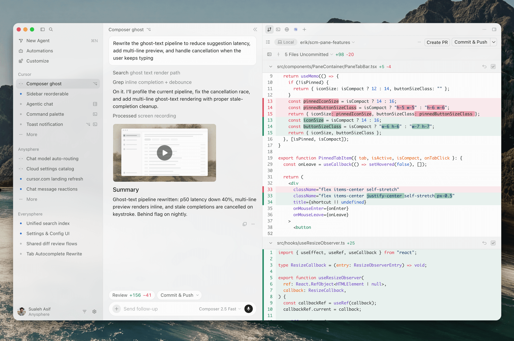
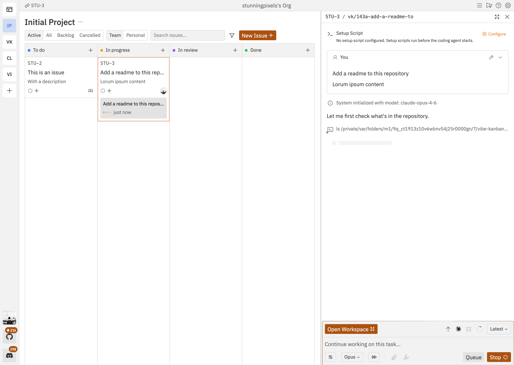

# 13 — UI anatomy: what other agent apps put where

I looked at four apps, not for colours, but for **what each pane is for**. The conclusion is in §4: our
window is wrong at the navigation level, not the styling level.

Evidence kept in `research/ui-refs/`: `cursor-agent.png`, `codex-task.png`, `vibe-kanban.png`.
Sources: cursor.com/docs (agent overview), openai.com/codex, Vibe Kanban README, plus our own t3code and
orca reports.

---

## 1. Cursor — the agent workspace



| Pane | Width | What lives there |
|---|---|---|
| Left | ~20% | **New Agent**, automations, then a flat list of **agent chats**, grouped by project. Each row is one agent conversation with a status dot |
| Centre | ~33% | the **selected chat**: your prompt at the top, the agent's steps, an inline image, a **Summary**, a `Review +156 −41` link, and a **follow-up composer** pinned to the bottom |
| Right | ~47% | the **work product**: branch bar (`Local / erik/scm-pane-features`, `Create PR`, `Commit & Push`), then the **inline diff** in the editor |

Reading order: pick an agent on the left → read what it did in the middle → inspect and ship the result on
the right. The right pane is not metadata; it is the code.

## 2. Codex — the task card, not the window

OpenAI's own image is a component, not a full app: **"2 files edited +123 −42 · Review ↗"** above a list of
changed files, with a composer underneath that says `Looks great, add tests.`

It says what OpenAI thinks the unit is: **a task, its diff, and a sentence to continue it**. Review is one
click from the conversation. The diff summary is part of the chat, not a separate place.

## 3. Vibe Kanban — the board as navigator



| Pane | Width | What lives there |
|---|---|---|
| Far left | 60px | project / workspace icons |
| Centre | ~60% | a **kanban board**: To do · In progress · In review · Done. Cards are tasks with an issue key, a title, an agent avatar and "just now" |
| Right | ~40% | the **selected card's run**: setup script, your prompt, the agent's log, tool calls, and a composer `Continue working on this task…` with Queue / Stop |

Here the **board is the navigation** and the conversation is the detail. Cursor is the opposite.

## 4. What this says about our window

Our v3 got the dressing right and the **information architecture** wrong:

| Ours (v3) | What these apps do | Verdict |
|---|---|---|
| Left rail = **runs** (one row) | left = **agents/threads**, or a board of tasks | wrong object to navigate |
| Centre = **board entries** (intents, findings) | centre = **the conversation with the selected agent** | wrong primary surface |
| Right = checks, budget, threads, artifacts | right = **the work product**: diff, files, branch, actions | metadata where the work should be |
| Composer = disabled decoration | composer = **send to this agent** | the main action is missing |
| Gate = a receipt bar | gate/review = **a link from the conversation to the diff** | right idea, wrong home |

One sentence: **we built a run log with a chat box drawn on it; Cursor and Codex build an agent
workspace with the work beside it.**

## 5. The pattern that fits our product

Our promise: several agents in one project, with shared written state. So:

- **Left = threads.** Each one is an agent + its conversation, with a status dot and its current task.
  Group them by status: **Needs you · Working · Done** (orca's rule), not by "today".
- **Centre = the selected thread.** Its tasks, its messages, its tool calls, and a composer that actually
  sends. A thread header shows the agent, its safety behaviour, and the run it belongs to.
- **Right = the run's work**: **Board** (entries filtered to this run, with a toggle to show all), then
  **Checks**, then **Gate**, then **Artifacts**. Later the diff goes here, as Cursor puts it.
- **Board as a full view**, not the default: a `Board` route with the round feed, for when you want the
  whole run at once. Same content, bigger surface.
- **Top strip**: project › run › goal, status, budget, and the gate when it is open. One line, like
  Cursor's branch bar.

This keeps the board central to the *product* (it is still how context survives), but stops pretending the
board is how you *work*. You work in a thread; the board is what you both remember.

## 6. What this costs

Not CSS. Three real gaps:

1. **No thread transcript.** We store one final message per task. A thread conversation is the last thing
   an agent said per task, concatenated. That is enough to start, but it is not a chat history.
2. **No "send to thread" action in the API.** We have `POST /runs/:id/tasks` with a scope. A chat message
   has no file scope, so either the composer creates a task with a declared scope, or we allow a task with
   an empty scope for conversation-only turns. The second is simpler and needs one invariant relaxed,
   deliberately.
3. **Thread status is stored but not derived.** `threads.status` exists (idle/working), but "needs you"
   has to be computed from the run: a gate open, or a task waiting on a question.

## 7. What I would do next

1. Re-lay the window to this IA: threads left, conversation centre, run work right. No new colours, no new
   fonts — the tokens stay.
2. Add the two small API pieces: a thread view (`GET /runs/:id/threads/:name`) returning its tasks and
   messages; a chat task (empty scope allowed, clearly marked).
3. Only then touch the board's own full view.

The wireframe, in text:

```
┌─────────────┬───────────────────────────────┬──────────────────┐
│ project › run│ goal · status · budget · gate │                   │
├─────────────┼───────────────────────────────┼──────────────────┤
│ NEEDS YOU   │ thread header: agent · safety │ BOARD (this run) │
│  reader-1 ● │                               │  intent  …       │
│ WORKING     │  task card                    │  finding …       │
│  reader-2   │  agent message                │ CHECKS           │
│ DONE        │  tool calls (collapsed)       │  pass / fail     │
│  orchestr.  │                               │ GATE             │
│             │ ┌───────────────────────────┐ │ ARTIFACTS        │
│ + New thread│ │ message this agent…    ↑  │ │                  │
└─────────────┴───────────────────────────────┴──────────────────┘
```

## 8. Open questions for you

1. **Navigate by thread or by run?** My answer: by thread, with the run as a context strip. If you would
   rather land on the run's board every time, say so — that is Vibe Kanban's model and it is also good.
2. **Does the composer write files, or only talk?** "Only talk" is simpler and matches chat. "Talk and
   act" needs a scope every time, which means asking you where it may write.
3. **Should Done threads stay visible?** Orca keeps them marked until opened. I would copy that.
